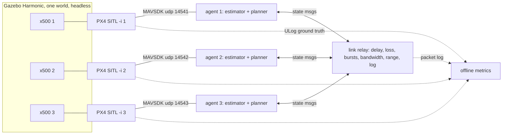

# 01: Phase 2 Plan: Multi-Drone Simulation (Shared State, Formation, Collision Avoidance)

> [!NOTE]
> **Later status (2026-10-04):** still nothing installed; the perception build has gone ahead without the simulator ([doc 03](03_build_plan.md)).
>
> **Status 2026-09-29: plan only. Nothing installed, no flight code written.** Facts were checked at the primary source on 2026-09-28/29 (links in §10). Numbers marked *[check]* come from [`tools/phase2_checks.py`](tools/phase2_checks.py) (`python tools/phase2_checks.py`, numpy only). Setup commands for you to run are in §9.

Phase 2 puts **2-3 simulated x500 quadcopters** in one Gazebo world under WSL2. The drones share their state over a deliberately imperfect simulated radio link, and we test **formation keeping** and **collision avoidance** before any hardware is involved. Detection by camera is phase 3. Here each drone knows the others only from what they tell it.

**Decisions in one table** (reasons in the sections cited)

| Question | Decision | § |
| :--- | :--- | :-: |
| Simulator | PX4 **v1.17.0** SITL + **Gazebo Harmonic**, in **WSL2 Ubuntu 24.04**, headless for experiments | 2 |
| IsaacLab | **Not on this laptop**: it needs 16 GB of VRAM and 32 GB of RAM (we have 8 GB and 16 GB) | 2.5 |
| How to command each drone | **MAVSDK 4 (Python)**, one agent process per drone; ROS 2 Jazzy deferred to phase 3 (camera images) | 3.1 |
| How drones share state | Our own 40-byte state message through a **seeded UDP relay** that injects delay, loss (random and bursty), a bandwidth cap and a range limit, and logs every packet | 3.3 |
| Where the planner runs | **In each drone's agent** (decentralised, as on a Pi 5); no central controller | 3.2 |
| First algorithms | Leader-follower with velocity feed-forward and dead-reckoning; **CBF safety filter** for avoidance (ORCA as the alternative); strip-split lawnmower coverage | 4 |
| Ground truth | PX4's own SITL ground-truth topics in each flight log (ULog) | 3.5 |

---

## 1. What Phase 2 Must Answer, in Order

1. **Does the stack run here, and how many drones fit?** Real-time factor, CPU and RAM for N = 1, 2, 3 and 5 x500s on this laptop (S0-S1).
2. **How well do drones know each other through shared state alone?** Error between where drone *i* believes drone *j* is and where it truly is, over an ideal link (S2).
3. **Can followers hold a formation?** Formation error with an ideal link (S3).
4. **How does that degrade with latency, loss and bursts, and does prediction recover it?** (S4-S5)
5. **Can drones avoid each other with no collisions, first over an ideal link and then a degraded one?** (S6-S7)
6. **What happens when the link fails completely?** The fail-safe must keep drones apart with zero information (S8).
7. **Can N drones split an area to cover and re-split when one drops out?** (S9, the wildfire-survey hook)

### 1.1 What "working" means (measured, not judged by eye)

All metrics come from **ground truth**, not from what the drones believe. Each configuration is repeated over **≥ 10 random seeds**, and results are reported with a **bootstrap interval over seeds**. As with videos in the sibling project, the seed is the independent unit, not the time step ([sibling doc 17 §7](https://github.com/JoshChomps/Drone-Detection/blob/main/17_design_process_and_lessons_learned.md#7-catalogue-of-what-went-wrong), #13).

| Metric | Definition | Proposed pass mark (for you to confirm) |
| :--- | :--- | :--- |
| **Contact** | Any pairwise centre distance < 2r = **0.77 m** (x500 envelope radius r = 0.386 m, §4.2) | **Zero, in every seed, in every experiment.** A single contact fails the configuration |
| **Separation** $d_{\min}$ | Minimum pairwise 3-D distance over the run; also time spent below $D_s$ | Never below $D_s$ ($D_s$ per scenario from the §4.2 table, e.g. 3 m at low speed) |
| **Formation error** | $\lVert p_i - p_i^\ast\rVert$, where $p_i^\ast$ is the slot computed from the leader's **true** pose; RMS, 95th percentile and max, after a 10 s settling window | RMS ≤ 1 m at 5 m/s with an ideal link; ≤ 1.5 m at 0.5 s delay or 30 % random loss |
| **Belief error** | $\lVert \hat p_j - p_j\rVert$: drone *i*'s estimate of *j* against truth | Reported, no target: it becomes the σ in the safety distance |
| **Age of information** | Time since the newest delivered state from *j* was sent; mean and 99.9th percentile | Reported; drives the fail-safe thresholds |
| **Efficiency** | Extra path length and time from avoidance manoeuvres; area coverage %, overlap % and completion time | Reported; compare algorithms at equal safety |
| **Fail-safe** | After total link loss, time to a safe state and $d_{\min}$ during it | No contact, $d_{\min} \ge D_s$ |

---

## 2. Simulator Stack (Verified)

### 2.1 Versions

| Component | Version to use | Evidence |
| :--- | :--- | :--- |
| PX4-Autopilot | **v1.17.0** (stable, 2026-05-13). v1.18.0-rc1 (2026-09-10) is a pre-release; don't chase it | GitHub releases API |
| Gazebo | **Harmonic**. PX4 v1.17's `Tools/setup/ubuntu.sh` installs `gz-harmonic` on both 22.04 and 24.04 | v1.17.0 source |
| Ubuntu (WSL2) | **24.04**. PX4 supports 22.04 and 24.04 under WSL2, and 24.04 is where ROS 2 **Jazzy**, PX4's "supported and recommended" ROS 2 platform, runs. That matters in phase 3 | PX4 WSL and ROS 2 docs |
| MAVSDK (Python) | **4.0.0** (2026-09-22): new native bindings with sync and asyncio APIs and explicit multi-system support; wheels for Linux x86_64 **and aarch64 (Pi 5)**. Fallback: `mavsdk<4`, which still works but gets no updates | MAVSDK release notes, migration guide, PyPI |
| Log reader | `pyulog` 1.2.4 (PX4's own) | PyPI |

### 2.2 WSL2 on this laptop

* **Measured 2026-09-28:** Windows 11 Home build 26200, i7-12650H (10 cores, 16 threads), 15.7 GB RAM, RTX 4060 Laptop 8 GB (driver 616.56). **WSL is not installed yet.** C: has 111 GB free (WSL installs there by default), D: has 487 GB.
* WSL2 by default gets **50 % of RAM (~7.8 GB) and all 16 logical processors**. Leave that until S1 shows it's too little ([wsl-config](https://learn.microsoft.com/en-us/windows/wsl/wsl-config)).
* Keep PX4 **inside the Linux file system** (`~/PX4-Autopilot`), not on `/mnt/d`: builds across the Windows boundary are slow. Our own small Python agents can live in this folder and run from `/path/to/Drone-to-Drone`.
* Stated limits (PX4 WSL page): no direct USB or serial access (irrelevant until phase 4), and the WSL IP changes on every restart.

### 2.3 How many x500s can the laptop run?

**The arithmetic first.** PX4 says notebooks reach about **3-4× real time for one x500** (desktops 6-10×). PX4 and Gazebo run in **lockstep**, so a slow simulation runs slower, not wrong. If the per-vehicle work were fully serial, N vehicles would run at roughly 3.5/N × real time: **N = 3 → ~1.2×** (just real-time), **N = 5 → ~0.7×**. In practice each PX4 instance is its own process on its own core, so the serial part is mainly Gazebo physics and the real numbers should be better. PX4 documents **no limit** on the number of vehicles.

**Expectation:** 3 at real time, 5 borderline. **S1 measures it** (real-time factor, CPU and RAM for N = 1, 2, 3, 5). Running headless (`HEADLESS=1`) "uses fewer resources" and needs no working GPU OpenGL.

**Consequence for the design (time base):** the agents and the link relay run on the wall clock. That is valid **only while the real-time factor stays near 1**. Every run logs its real-time factor and is flagged if it drops below 0.95. If S1 shows N = 3 below real time, the agents switch to PX4 timestamps (`time_boot_ms`, which is simulation time in lockstep). That also unlocks `PX4_SIM_SPEED_FACTOR` > 1 for fast seed sweeps.

### 2.4 GUI and QGroundControl

* **Gazebo GUI** comes through **WSLg** (Windows 11, hardware-accelerated OpenGL through the vGPU driver). Use it for looking, not for experiments. If rendering fails, PX4 suggests `PX4_GZ_SIM_RENDER_ENGINE=ogre`.
* **QGroundControl is optional in phase 2.** The agents talk MAVSDK directly. If you want QGC on Windows, PX4 says to add a **UDP link to port 18570** at the WSL IP (`ip addr | grep eth0`) and **update it after every WSL restart**. Vehicle instance *i* listens on **18570 + i**. Alternatively, **mirrored networking** (`[wsl2] networkingMode=mirrored` in `%UserProfile%\.wslconfig`, Windows 11 22H2+) lets Windows and WSL reach each other on `localhost` and supports multicast. That is untested with QGC here, so try it only if the IP juggling becomes annoying.

### 2.5 IsaacLab: checked, not for this laptop

IsaacLab's install page asks for **32 GB RAM and 16 GB VRAM**. Isaac Sim's *minimum* is an **RTX 4080 (16 GB), 32 GB RAM**. Our 4060 has 8 GB, of which Ollama already held ~3 GB at the check, and we have 16 GB of RAM. **Verdict: don't plan on IsaacLab locally.** If learning-based control is ever wanted, it would need cloud GPUs (a Colab A100 has the VRAM, but Isaac Sim needs a desktop/streaming setup that hasn't been checked). Gazebo covers everything in phase 2.

---

## 3. Software Architecture



Two kinds of link, deliberately kept separate:

* **Agent ↔ its own autopilot** (MAVSDK over local UDP) stands in for the companion computer's serial cable to the flight controller: reliable and fast, **never degraded**.
* **Drone ↔ drone** (through the relay) stands in for the radio: **the only link we degrade**.

### 3.1 Commanding each drone: MAVSDK now, ROS 2 later

PX4's own guidance: *"We recommend using MAVSDK where possible"* (easier, lighter, runs on less powerful hardware). **ROS 2** is preferred if you already know it, need existing integrations "for example computer vision", or need very low latency or deeper PX4 integration. Phase 2 needs none of those, so **MAVSDK**. Phase 3 (simulated camera images, detector nodes) is the natural point to decide on ROS 2 Jazzy. The PX4 side is ready: every instance already runs a uXRCE-DDS client on port 8888 with topics namespaced `/px4_i/`.

**Control mode:** Offboard **velocity setpoints (NED)** at 20 Hz. PX4 needs a setpoint stream of at least **2 Hz** as "proof of life". If the agent dies, PX4's own failsafe fires after **`COM_OF_LOSS_T` = 0.5 s** (default), which is a useful last line of defence we get for free.

**Ports and IDs** (read from the v1.17 `px4-rc.mavlink` and `rcS` scripts). We use instances **1-3**, as PX4's multi-vehicle example does, so every vehicle gets a ROS 2 namespace (instance 0 gets none):

| Instance `-i` | `MAV_SYS_ID` | MAVSDK connects to | QGC (GCS) port | ROS 2 namespace | Spawn `PX4_GZ_MODEL_POSE` |
| :-: | :-: | :--- | :-: | :--- | :--- |
| 1 | 2 | `udpin://0.0.0.0:14541` | 18571 | `/px4_1/` | `"0,0"` (first instance also starts Gazebo) |
| 2 | 3 | `udpin://0.0.0.0:14542` | 18572 | `/px4_2/` | `"0,5"` |
| 3 | 4 | `udpin://0.0.0.0:14543` | 18573 | `/px4_3/` | `"0,10"` |

Rule from the source: the offboard port is 14540 + i, up to i = 9. From instance 10 on, all instances share 14549, so **N ≤ 9** keeps this simple scheme.

### 3.2 One agent per drone, planner inside it

Each agent is one Python process (MAVSDK 4 asyncio), doing what a Pi 5 on the drone would do:

1. read own state from PX4 (position, velocity, 10-50 Hz);
2. publish own state to the relay at 10 Hz;
3. receive neighbours' states, keep an **estimate per neighbour** (last message propagated at constant velocity, plus the message's age);
4. run the **planner** (formation → avoidance filter → limits) and send a velocity setpoint at 20 Hz;
5. run the **fail-safe** (§4.4) when information is too old.

No agent reads another agent's memory or Gazebo's truth. That rule is what makes the phase-2 results transferable to hardware. A small **scenario runner** starts the PX4 instances, the relay and the agents with a seed and a config file, then collects the logs.

### 3.3 Shared state: message, frames, link model

**Message** (40 bytes of payload, 52 bytes framed like MAVLink 2): send time, latitude, longitude and altitude (int32), velocity NED (int16, cm/s), yaw, flags (mode, health, fail-safe), sequence number, and the current goal (lat/lon/alt). **Bandwidth:** 3 drones at 10 Hz need **12.5 kbit/s**; 5 drones need 20.8 kbit/s *[check]*. State sharing is cheap. **Images never go over this link**: one compressed frame is tens of kB, a thousand times one state message.

**Common frame:** drones share **latitude/longitude/altitude**, not PX4 local positions. Each PX4 instance's local frame starts at its own home, so local positions from different drones don't line up. Every agent converts to one **ENU frame** about a shared reference point with the exact ECEF→ENU formula (a few lines of numpy). Using a flat-earth shortcut with a *spherical* 6371 km radius would put in **2.1 m of error at 1 km** at BC latitudes. With the proper ellipsoid radii it is 10 cm *[check]*. Two metres matters when the safety distance is 3 m.

**Link relay** (plain Python UDP, seeded, one process). It applies these per directed link *i → j*:

| Impairment | Model | Why this one |
| :--- | :--- | :--- |
| Delay | fixed + random jitter | Tests prediction (§4.1) |
| Random loss | Bernoulli *p* | Simplest baseline |
| **Bursty loss** | **Gilbert-Elliott** two-state channel (Gilbert 1960) | Real radios lose packets in bursts, and **bursts, not the average, set the safety margin**: at the same 9 % average loss, bursts leave 99.9th-percentile gaps of **1.5 s** against **0.3 s** for random loss *[check]* |
| Bandwidth cap | token bucket on the shared channel, queueing if exceeded | Latency grows with load, as on a real shared radio |
| Range limit | drop if sender-receiver distance > R (using the sender's reported position) | Mountains, spread-out coverage |
| Outage | all links down for T seconds | Fail-safe test (S8) |

The relay logs every packet (sent, delivered or dropped, delivery time), so age of information comes out exactly. The formulas were checked numerically: at 10 Hz the mean age is $T(1+p)/(2(1-p))$, i.e. 50 ms with no loss and 93 ms at 30 % loss *[check]*.

We use our own relay rather than Linux `tc netem` because it is deterministic, seedable, identical on any machine, and doesn't depend on WSL kernel modules (not checked).

### 3.4 Where the planner runs, and why not centrally

A central planner seeing all states perfectly would make formation and avoidance easy, and it would tell us nothing about radio loss. The whole point of phase 2 is to learn what breaks when information is late or missing, so **the planner is decentralised from day one**. A central "oracle" run (same algorithm fed true states) is still useful as a **best-case reference** in S3 and S6.

### 3.5 Ground truth and logging

PX4 SITL logs **`vehicle_local_position_groundtruth` at 50 Hz** and **`vehicle_global_position_groundtruth` at 10 Hz** in every flight log (`logged_topics.cpp`, SITL block). Metrics use the 50 Hz local truth shifted by each vehicle's spawn offset, **cross-checked in S1 against the global truth**, since whether the local ground-truth origin equals the spawn point is not yet confirmed. `pyulog` reads the logs. Logs and results live in **`~/d2d_runs/` inside WSL, not in this folder**, following the sibling's rule of keeping data out of the project.

---

## 4. Algorithms, Simplest First (Maths Checked)

### 4.1 Formation: leader-follower

The leader flies a scripted path (straight legs, a 20 m-radius circle, a box). Follower *i* holds slot $o_i$ in the leader's heading frame:

$$p_i^\ast = \hat p_L + R(\hat\psi_L)\,o_i,\qquad v_i^{cmd} = \hat v_L + K\,(p_i^\ast - p_i),\quad \text{clipped to } v_{max}$$

Three facts, each checked numerically *[check]*:

* **Velocity feed-forward is essential.** Without the $\hat v_L$ term, a P controller lags a moving slot by $v/K$: **5 m at 5 m/s with K = 1**. With it, the steady error is ~0.
* **Stale leader state costs $v\tau$ of formation error.** At 5 m/s, 0.5 s of delay puts the slot 2.5 m behind. **Constant-velocity prediction** ($\hat p_L = p_L + v_L\,\tau_{age}$) cuts that to $a\tau^2/2$: **0.16 m** on a 20 m circle (1.25 m/s²). Message ages are known exactly from the send time in the message, so prediction is nearly free.
* **Delay limits the gain.** A position loop through a delay τ is stable only if $K\tau < \pi/2$ (checked: K = 1 is stable at τ = 1.5 s and unstable at 1.6 s). With τ up to 1 s, **keep K ≤ 0.5-1 s⁻¹**. PX4's own velocity loop adds lag on top, which is why S3 measures rather than assumes.

Consensus-based or virtual-structure formations are later options. Leader-follower is the simplest thing with a clear failure mode (lose the leader, lose the formation), and S8 tests exactly that.

### 4.2 Collision avoidance

**Safety distance.** The two drones must stay apart by at least

$$D_s = 2r + 2\sqrt2\,\sigma + v_c\,(\tau_{age} + t_{react}) + \frac{v_c^2}{4a}$$

where r = 0.386 m is the x500's envelope radius (rotor hub 0.246 m + prop 0.140 m, from the model file), σ is the per-drone position error (0.5 m assumed until S2 measures it), $v_c$ the closing speed, $t_{react}$ = 0.2 s, and a = 3 m/s² braking. PX4's default `MPC_ACC_HOR` is 3; `MPC_ACC_HOR_MAX` is 5. S1 measures real stopping distances *[check]*:

| Closing speed | τ = 0.1 s | τ = 0.5 s | τ = 1.0 s |
| :-: | :-: | :-: | :-: |
| 2 m/s | 3.1 m | 3.9 m | 4.9 m |
| 5 m/s | 5.8 m | 7.8 m | 10.3 m |
| 10 m/s | 13.5 m | 17.5 m | 22.5 m |

Closing speed dominates. Two drones at the default 5 m/s cruise (`MPC_XY_CRUISE`) meeting head-on close at 10 m/s, which needs **13-23 m**. Formation spacing and speeds must be chosen with this table in hand.

**Layers, simplest first:**

1. **Altitude layers (no communication).** Each drone gets its own altitude band (e.g. 3 m apart) for transit. It is the fallback when the link is gone (§4.4), and the baseline every smarter method must beat on efficiency.
2. **Control barrier function (CBF) safety filter** (Wang, Ames & Egerstedt 2017). Each agent takes the formation's velocity command and changes it as little as possible so that $h = \lVert p_i - p_j\rVert^2 - D_s^2$ satisfies $2(p_i-p_j)\cdot v_i \ge -\gamma h/2$. Each drone takes half the burden, so it needs only its neighbours' **positions**. With one neighbour that is a projection onto a half-plane; with several it is a tiny quadratic program.
3. **ORCA** (reciprocal velocity obstacles; van den Berg et al. 2008, 2011) as the comparison method. The authors' reference libraries **RVO2 and RVO2-3D** are Apache-2.0.

**Numerical check of the CBF**: two drones swap ends head-on at 5 m/s each, $D_s$ = 3 m, velocity changes limited to 3 m/s², neighbour position τ seconds old. Values are $d_{\min}$ in m; \* = below $D_s$, ! = **contact** *[check]*:

| γ | τ | plain | + prediction | + prediction + inflate $D_s$ by $v\tau$ |
| :-: | :-: | :-: | :-: | :-: |
| - | - | **no avoidance: 0.50 !** | | |
| 0.5 | 0 / 0.5 / 1.0 | 7.23 / 7.03 / 6.46 | 7.23 / 7.29 / 7.46 | 7.23 / 8.25 / 9.89 |
| 1.0 | 0 / 0.5 / 1.0 | 4.86 / 4.41 / 3.50 | 4.86 / 4.93 / 5.18 | 4.86 / 6.43 / 8.64 |
| 3.0 | 0 / 0.5 / 1.0 | 1.19\* / 0.63 ! / 0.52 ! | 1.19\* / 1.20\* / 1.19\* | 1.19\* / 2.02\* / 3.82 |

What the table says:

* **The baseline collides** (0.50 m < 0.77 m), so the scenario is a real test. A test must fail on the bug it guards ([sibling doc 17 §7](https://github.com/JoshChomps/Drone-Detection/blob/main/17_design_process_and_lessons_learned.md#7-catalogue-of-what-went-wrong), #12).
* **The CBF's guarantee assumes the drone can change velocity instantly.** With realistic acceleration limits, an aggressive γ = 3 lets drones get too close, **even with fresh data**. With γ ≤ 1 there are no violations up to 1 s of stale data. So **γ is a safety parameter, not a tuning knob**: pick it so the braking it demands is within the drone's acceleration. The alternative is the braking-aware (double-integrator) barrier from the same paper; try it if γ ≤ 1 proves too conservative.
* **Prediction and inflation help most when γ is marginal**, and cost efficiency (wider berths) when it isn't.

This is a 2-D point-mass model. PX4's real velocity response is slower still, which is exactly what S6-S7 measure.

Time to collision ([sibling doc 09 §1.3](https://github.com/JoshChomps/Drone-Detection/blob/main/09_monocular_depth_frame_tracking_and_kinematics.md#13-method-c-looming-cues--optical-expansion-time-to-collision)), $d/v_c$ from shared states, sets **which** neighbour the filter prioritises and when the agent logs a "conflict".

### 4.3 Area coverage (wildfire hook)

Split a rectangle into N strips of equal area (unequal if endurance differs). Each drone flies a lawnmower (boustrophedon) pattern in its strip at its own altitude layer, so strips never need avoidance except at the boundaries and during transit. **Scale check** *[check]*: a camera at 60 m AGL with 45° horizontal FOV sweeps a **49.7 m** swath. 1 km² then needs 21 legs, 22 km in total: **46 min for one drone, 15 min each for three** at 8 m/s. That is exactly why coverage wants several drones. **Re-split on dropout:** when a drone's state goes stale beyond the fail-safe limit, the others divide its uncovered remainder. Voronoi / Lloyd coverage control (Cortés et al. 2004) is the later upgrade for irregular areas like a fire perimeter.

### 4.4 Fail-safes (designed now, tested in S8)

| Condition | Action |
| :--- | :--- |
| A neighbour's info is older than **T_warn** (e.g. 0.5 s) | Inflate $D_s$ by $v_c\tau_{age}$ for that neighbour; keep predicting |
| Older than **T_stale** (e.g. 2 s; the bursty loss above gives 99.9th-percentile gaps of 1.5 s) | Stop formation keeping; **brake to hover and move to own altitude layer** |
| Own autopilot link lost | PX4's own offboard-loss failsafe after 0.5 s (`COM_OF_LOSS_T`) |

All thresholds get tuned from S5's measured age distributions, not guessed.

---

## 5. Experiment Sequence (One Change Each)

Each experiment changes **one thing** from the one before and saves its config, seed list, real-time factor and logs. "Fail" rows say what a failure would teach, so a failed run is still useful.

| # | Question | The one change | Measure | Success | A failure would show |
| :-: | :--- | :--- | :--- | :--- | :--- |
| **S0** | Does the stack run? (**smoke test**) | Install; one x500, headless, `commander takeoff` / `land` from the PX4 shell | Builds, takes off, lands; log file written; `pyulog` reads the ground-truth topics | All four | Install or WSL problem; fix before anything else |
| **S1** | How many drones fit, and is the timing valid? | N = 1, 2, 3, 5 x500s, hovering; then one stop from 5 m/s | Real-time factor (Gazebo stats topic), CPU, RAM, stopping distance; local vs global ground truth agree to the spawn offsets | N = 3 at real-time factor ≥ 0.95 | Switch to simulation-time agents (§2.3) or limit N |
| **S2** | How well does shared state alone locate a neighbour? | Agents + relay, **ideal link**, 3 drones on scripted paths | Belief error (→ σ for §4.2), age of information | Belief error ≈ PX4's own position error | Frame or time-conversion bug (§3.3); fix before any control |
| **S3** | Can followers hold a formation? | Leader-follower, ideal link, straight + circle + box at 5 m/s; oracle run as reference | Formation error RMS / p95 / max | RMS ≤ 1 m | Gain or feed-forward problem; PX4 velocity-loop lag larger than assumed |
| **S4a** | What does delay cost? | Delay 0, 0.1, 0.25, 0.5, 1.0 s, **no prediction** | Formation error vs delay (expect ≈ $v\tau$) | Matches §4.1 | Model mismatch: find out why before S4b |
| **S4b** | Does prediction fix it? | Add constant-velocity prediction | Same | RMS ≤ 1.5 m at 0.5 s | Leader manoeuvres too hard for constant velocity → try a constant-turn model (sibling doc 09 IMM) |
| **S5a** | What does random loss cost? | Bernoulli 0, 10, 30, 50 % | Formation error, age of information | ≤ 1.5 m at 30 % | - |
| **S5b** | And bursts? | Gilbert-Elliott at the **same average** loss as S5a | Same, plus 99.9th-percentile age | Reported; sets T_stale | Averages hide the risk (expected: §3.3) |
| **S6a** | Is the scenario hard enough? | Head-on, crossing (90°), 3-way swap, **no avoidance** | $d_{\min}$ | **Must show contact** | The scenario is too easy; redesign it |
| **S6b** | Does avoidance work? | Add CBF filter (γ = 0.5, 1), ideal link; then ORCA as a separate run | Contacts, $d_{\min}$, extra path and time | Zero contacts, $d_{\min} \ge D_s$ in all seeds | Acceleration-limit effect larger than modelled → smaller γ or braking-aware barrier |
| **S7** | Avoidance with a bad link? | S6b + S4/S5 impairments (delay, then random loss, then bursts, one at a time) | Same | Zero contacts up to 0.5 s delay / 30 % loss | Needs inflation or prediction; find the limit |
| **S8** | Total link loss | 5 s and 30 s outages mid-formation and mid-crossing | Time to safe state, $d_{\min}$ | No contact, fail-safe reached before T_stale + 2 s | Fail-safe too slow or layers too close |
| **S9** | Coverage and dropout | 3 drones, strip split of a 300 × 300 m area; then kill one drone mid-mission | Coverage %, overlap, time, re-split delay | 100 % covered after re-split | Re-split logic or stale-detection bug |

Optional **S10**: N = 5 (if S1 allows) repeating S6b-S7, since conflicts grow with the number of pairs (10 pairs at N = 5 vs 3 at N = 3).

---

## 6. Later Hooks (Phase 3 and Mode 2)

* **Simulated air-to-air training data.** Gazebo can render cameras. PX4 lists camera-equipped x500 variants such as `x500_depth`, and a custom forward camera is a small model edit. Every drone's **true pose is already logged**, so projecting the others' true poses through the camera model gives **perfect bounding boxes**. Pixels on target decide what is useful *[check]*: an x500 (0.77 m across) seen by a 1280-px, 90° camera is **20 px at 25 m, 10 px at 50 m, 5 px at 100 m**. The sibling's measured $w_{\min}$ of 8 px puts detection out to **~62 m** ([sibling doc 13 §2](https://github.com/JoshChomps/Drone-Detection/blob/main/13_system_requirements_and_geometry_budget.md#2-pixels-on-target-the-constraint-that-dominates-everything)). Real camera rendering uses the GPU, so check `nvidia-smi` first (§7).
* **Reusing `cuas` without copying.** In the WSL venv, add one path file:
  `echo "/path/to/.Drone Detection" > "$(~/d2d_venv/bin/python -c 'import site; print(site.getsitepackages()[0])')/cuas_sibling.pth"`.
  Then `import cuas` works and always uses the sibling's current code. **What carries over:** the detector interface (`cuas/detector.py`: `detect_in_crops`, `nms`), tiling (`grid_tiles`, `crops_around`, `training_tiles`), zoom-out distance simulation, and evaluation by size with per-video bootstrap intervals (`cuas/eval.py`). **What does not:** `cuas.motion`. It assumes a fixed camera, and ours flies ([README §7.4](README.md#74-what-carries-over-from-drone-detection-and-what-does-not)). Training itself stays on the sibling's Windows GPU venv or Colab.
* **Fusion.** Once cameras give bearings, the per-neighbour estimate of §3.2 becomes a Kalman / IMM filter fusing shared state and camera bearings in world coordinates ([sibling doc 09 §3.3](https://github.com/JoshChomps/Drone-Detection/blob/main/09_monocular_depth_frame_tracking_and_kinematics.md#33-interacting-multiple-model-imm-filter)).
* **Mode 2 (simulation only, later).** The same framework with one vehicle that **shares nothing**: the others must keep it in view using only simulated sensing, while staying outside a stand-off distance. The avoidance filter of §4.2 becomes the keep-away guarantee. Observation and keep-in-view only: no contact, no interference, never a real third-party aircraft.
* **Pi 5.** MAVSDK 4 ships aarch64 wheels, so the agent code should run on the drone unchanged. Its CPU share next to a detector is a question for sibling [doc 18 §4](https://github.com/JoshChomps/Drone-Detection/blob/main/18_hardware_optimisation_and_realtime_latency.md#4-compute-detector-tiles-per-second).

---

## 7. Compute and the Shared GPU

* **Phase 2 is CPU-bound.** Headless Gazebo, PX4 and the Python agents need no GPU. The only GPU use is the optional WSLg window. It won't disturb Ollama or the paused E14 training.
* **At the 2026-09-28 check**, Ollama's `llama-server` held **~3 GB of the 4060's 8 GB**.
* **Before any GPU-heavy step** (Gazebo camera rendering for phase 3, any training), run `nvidia-smi` and **ask first**. The sibling's E14 training is paused and must not be resumed from here.
* **CPU contention:** 3-5 PX4 instances plus Gazebo will load the CPU heavily. Run experiments on AC power with sleep off (sibling lesson #15), and not while a local LLM is generating.

---

## 8. Open Questions for You

1. **Install approval:** OK to install WSL2 + Ubuntu 24.04 (on C:, ~111 GB free) and PX4 + Gazebo inside it (roughly 10-20 GB, unmeasured)? The steps are in §9; nothing has been installed.
2. **Pass marks:** accept the §1.1 targets (zero contacts; formation RMS ≤ 1 m ideal, ≤ 1.5 m degraded)?
3. **Speeds and spacing:** is 5 m/s cruise and ~5 m formation spacing representative? The §4.2 table shows head-on encounters at 5 m/s each need 13-23 m, so fast crossing flights need wide spacing or altitude layers.
4. **Swarm size:** stay at 3, or plan for 5? (The future CAR 901.40 limit of 5 is not a constraint now; this is about compute and the S10 run.)
5. **Coverage test area:** a plain rectangle first, then a realistic fire-perimeter polygon from `../Wildfire_Survey`?
6. **ROS 2:** agree to defer it to phase 3?
7. **Version control:** this folder isn't a git repo. Initialise one before code starts (no commits unless you ask)?

---

## 9. Setup Steps (for You to Run; Nothing Has Been Installed)

Run these one at a time and send back the output listed in **What to send back**. They follow the PX4 WSL guide, pinned to v1.17.0.

1. **Install WSL2 + Ubuntu 24.04.** Open *PowerShell as Administrator*:
   ```powershell
   wsl --install -d Ubuntu-24.04
   ```
   Reboot if asked. Ubuntu then opens and asks you to create a Linux username and password (your own choice; it is local to WSL).

2. **Update Ubuntu.** In the Ubuntu terminal:
   ```bash
   sudo apt update && sudo apt -y upgrade
   ```

3. **Get PX4 v1.17.0** (into the Linux home, not `/mnt/d`):
   ```bash
   cd ~ && git clone --recursive --branch v1.17.0 https://github.com/PX4/PX4-Autopilot.git
   ```

4. **Install PX4's toolchain and Gazebo Harmonic:**
   ```bash
   bash ./PX4-Autopilot/Tools/setup/ubuntu.sh
   ```
   Then restart WSL. In PowerShell (not admin):
   ```powershell
   wsl --shutdown
   ```
   and reopen Ubuntu.

5. **Smoke test S0 (headless, one x500).** The first build takes a while:
   ```bash
   cd ~/PX4-Autopilot && HEADLESS=1 make px4_sitl gz_x500
   ```
   At the `pxh>` prompt type `commander takeoff`, wait ~15 s, then `commander land`, wait until it has landed, then press **Ctrl+C**.

6. **Machine report:**
   ```bash
   lsb_release -ds; nproc; free -h; df -h ~; gz sim --version; git -C ~/PX4-Autopilot describe --tags; nvidia-smi --query-gpu=name,memory.used,memory.total --format=csv
   ```

7. **GUI check (optional):** same as step 5 without `HEADLESS=1`. Does a Gazebo window with the drone appear? If it's black or crashes, try:
   ```bash
   cd ~/PX4-Autopilot && PX4_GZ_SIM_RENDER_ENGINE=ogre make px4_sitl gz_x500
   ```

8. **Python environment for the agents:**
   ```bash
   sudo apt install -y python3-venv && python3 -m venv ~/d2d_venv && ~/d2d_venv/bin/pip install mavsdk==4.0.0 pyulog numpy && ~/d2d_venv/bin/python -c "import mavsdk, pyulog, numpy; print('ok')"
   ```

**What to send back:**
* Step 5: the last ~30 lines, including any `ERROR`/`WARN` lines and whether it took off and landed.
* Step 6: the whole output.
* Step 7: whether the window appeared, and which command worked.
* Step 8: whether it printed `ok`.
* Anything that failed, with its first error line.

Next after that: I write the S1 launch script (N = 1, 2, 3, 5 with real-time-factor logging), with your go-ahead.

---

## 10. Sources (Checked 2026-09-28/29)

**PX4 documentation:**
[multi-vehicle Gazebo](https://docs.px4.io/main/en/sim_gazebo_gz/multi_vehicle_simulation) (Linux only; `-i`, `PX4_GZ_STANDALONE`, `PX4_GZ_MODEL_POSE`; `/px4_i/` namespaces) ·
[Gazebo simulation](https://docs.px4.io/main/en/sim_gazebo_gz/) (Harmonic on 22.04; Harmonic/Ionic/Jetty on 24.04; `HEADLESS=1`; `PX4_SIM_SPEED_FACTOR`, notebooks ~3-4×; `PX4_GZ_SIM_RENDER_ENGINE=ogre`) ·
[Windows WSL2 setup](https://docs.px4.io/main/en/dev_setup/dev_env_windows_wsl) (Ubuntu 22.04/24.04; QGC UDP 18570; IP changes on restart; no USB) ·
[simulation ports and lockstep](https://docs.px4.io/main/en/simulation/) ·
[robotics APIs](https://docs.px4.io/main/en/robotics/) (MAVSDK recommended "where possible") ·
[ROS 2 user guide](https://docs.px4.io/main/en/ros2/user_guide) (Jazzy on 24.04 recommended; Humble on 22.04) ·
[Offboard mode](https://docs.px4.io/main/en/flight_modes/offboard) (≥ 2 Hz; `COM_OF_LOSS_T` 0.5 s).

**PX4 v1.17.0 source** (the docs above are for `main`, so version-sensitive facts were read from the tag):
[releases](https://github.com/PX4/PX4-Autopilot/releases) ·
[`Tools/setup/ubuntu.sh`](https://github.com/PX4/PX4-Autopilot/blob/v1.17.0/Tools/setup/ubuntu.sh) (gz-harmonic) ·
[`px4-rc.mavlink`](https://github.com/PX4/PX4-Autopilot/blob/v1.17.0/ROMFS/px4fmu_common/init.d-posix/px4-rc.mavlink) (ports) ·
[`rcS`](https://github.com/PX4/PX4-Autopilot/blob/v1.17.0/ROMFS/px4fmu_common/init.d-posix/rcS) (`MAV_SYS_ID`, uXRCE-DDS 8888, namespaces) ·
[`logged_topics.cpp`](https://github.com/PX4/PX4-Autopilot/blob/v1.17.0/src/modules/logger/logged_topics.cpp) (SITL ground truth) ·
[`mc_pos_control` params](https://github.com/PX4/PX4-Autopilot/tree/v1.17.0/src/modules/mc_pos_control) (`MPC_ACC_HOR` 3, `MPC_ACC_HOR_MAX` 5, `MPC_XY_VEL_MAX` 12, `MPC_XY_CRUISE` 5) ·
[x500 model SDF](https://github.com/PX4/PX4-gazebo-models/blob/main/models/x500_base/model.sdf) (rotor hubs at ±0.174 m, props 0.279 m long).

**MAVSDK and tools:**
[MAVSDK v4.0.0 release](https://github.com/mavlink/MAVSDK/releases/tag/v4.0.0) ·
[Python migration guide](https://mavsdk.mavlink.io/v4/en/python/migration.html) ·
[PyPI mavsdk](https://pypi.org/project/mavsdk/) (4.0.0 wheels incl. manylinux x86_64 and aarch64) ·
[pyulog](https://github.com/PX4/pyulog) ·
[MAVLink 2 serialization](https://mavlink.io/en/guide/serialization.html) (10-byte header, 2-byte CRC).

**Microsoft WSL:**
[networking](https://learn.microsoft.com/en-us/windows/wsl/networking) (mirrored mode, Win 11 22H2+) ·
[`.wslconfig`](https://learn.microsoft.com/en-us/windows/wsl/wsl-config) (defaults: 50 % RAM, all logical CPUs) ·
[GUI apps / WSLg](https://learn.microsoft.com/en-us/windows/wsl/tutorials/gui-apps).

**NVIDIA:**
[IsaacLab installation](https://isaac-sim.github.io/IsaacLab/main/source/setup/installation/index.html) (32 GB RAM, 16 GB VRAM) ·
[Isaac Sim requirements](https://docs.isaacsim.omniverse.nvidia.com/latest/installation/requirements.html) (minimum RTX 4080 16 GB, 32 GB RAM).

**Papers** (metadata checked on Crossref):
* J. van den Berg, M. Lin, D. Manocha, "Reciprocal Velocity Obstacles for real-time multi-agent navigation", *ICRA 2008*, [10.1109/ROBOT.2008.4543489](https://doi.org/10.1109/ROBOT.2008.4543489).
* J. van den Berg, S. J. Guy, M. Lin, D. Manocha, "Reciprocal n-Body Collision Avoidance" (ORCA), *Springer Tracts in Advanced Robotics*, 2011, pp. 3-19, [10.1007/978-3-642-19457-3_1](https://doi.org/10.1007/978-3-642-19457-3_1). Code: [RVO2](https://github.com/snape/RVO2), [RVO2-3D](https://github.com/snape/RVO2-3D) (Apache-2.0).
* L. Wang, A. D. Ames, M. Egerstedt, "Safety Barrier Certificates for Collisions-Free Multirobot Systems", *IEEE T-RO* 33(3), 2017, [10.1109/TRO.2017.2659727](https://doi.org/10.1109/TRO.2017.2659727).
* J. Cortés, S. Martínez, T. Karataş, F. Bullo, "Coverage Control for Mobile Sensing Networks", *IEEE T-RA* 20(2), 2004, [10.1109/TRA.2004.824698](https://doi.org/10.1109/TRA.2004.824698).
* E. N. Gilbert, "Capacity of a Burst-Noise Channel", *Bell System Technical Journal* 39(5), 1960, [10.1002/j.1538-7305.1960.tb03959.x](https://doi.org/10.1002/j.1538-7305.1960.tb03959.x).
