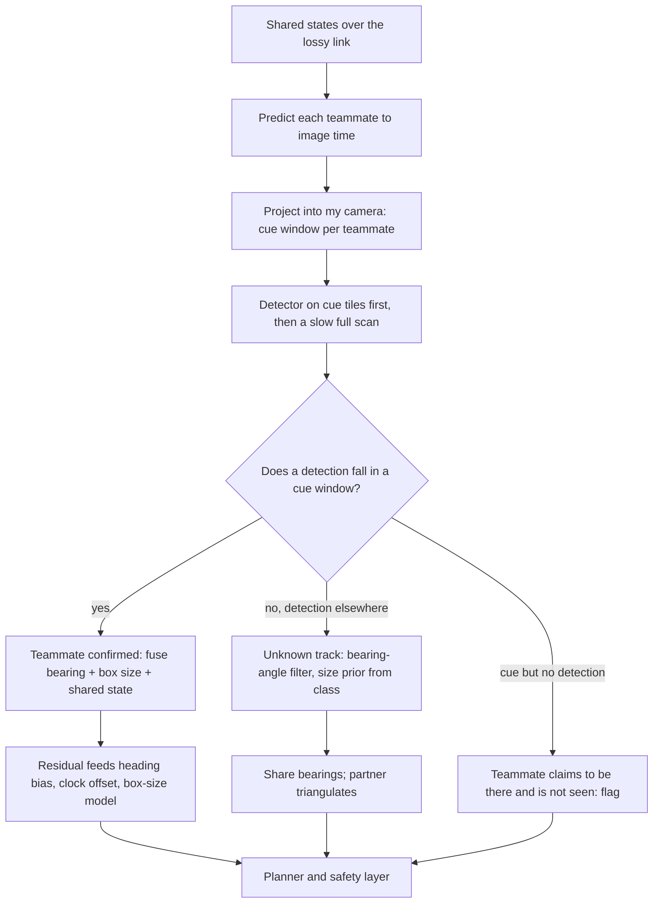

# 02: Research Survey, Gaps, and Trialled Directions (Drone-to-Drone Detection and Tag)

> [!NOTE]
> **Correction 2026-10-05 (sources behind cueing read at the source; [build log §11](04_build_log.md)):** gaps G1 and G3 in §3 are narrower than written. **G3:** Opromolla [72] (Sensors 2020) calibrated a UAV's heading from a second vehicle seen by its camera with *pseudorange* GNSS (DGPS or two position fixes), not carrier-phase: 7.4° → 2.7° mean heading error, 70-107 m apart, two vehicles, processed offline. What is left for us is online, several teammates at once, inside a multi-target tracker. **G1:** Omni-swarm [41] does project the swarm's estimated drone states into the image as boxes and matches them to detections (global nearest neighbour, box overlap, Hungarian), so cue-then-label is prior art; its detector still runs on the whole image, so "the cue tells the detector where to look" is still not found. [59] (Wen et al., arXiv 2023) estimates clock offset jointly with bearing-based mutual localisation (abstract read). [41], [59], [72] are now **P**; [70] and [71] (MDPI) refused the fetch and stay **S**.
>
> **Later status (2026-10-04):** the build started after this survey ([doc 03](03_build_plan.md), [build log](04_build_log.md)). The tag game (§5.5, T1-T4) is set aside; §5.4's single-observer figure is superseded by doc 03 §5.
>
> **Status 2026-10-03: research only. Nothing installed, no flight code.** 72 web searches; 15 source pages fetched; the key sections of three papers read in the PDF text (bearing-angle, STT, Schilling's flocking) and two more skimmed. The numbers in §5 come from [`tools/research_checks.py`](tools/research_checks.py) (`python tools/research_checks.py`, numpy only, ~90 s).
>
> **How far each source was checked** (the project rule is primary-source verification, so the level is marked on every entry in §8):
> * **P** = read at the primary source in this session (arXiv page, paper PDF, vendor or lab page).
> * **D** = already verified in [doc 01](01_phase2_simulation_plan.md) or in the sibling's paper database.
> * **S** = found by search only. Title and link are as the search returned them; the one-line description is a search summary and **has not been checked at the source**. Verify an S entry before a design decision rests on it.

**Purpose (user, 2026-10-03):** a purely academic, in-house robotics exercise: our own drones **detect each other and play tag**. Tag here is virtual: a drone is tagged when a pursuer holds it inside a tag zone for a set time, confirmed by camera. No contact, no payloads, no interference with anyone else's aircraft. This is the README's mode 2 with our own drones as the players.

---

## 1. Summary

### 1.1 The field in one table

| Sub-problem | State of the art | What it runs on | Gap for a Pi-5-class, fixed-camera, GNSS quad |
| :--- | :--- | :--- | :--- |
| See a drone from a drone | Appearance + motion networks (YOLOMG, GLAD, TransVisDrone); targets are a few pixels; ego-motion compensation is the hard part | Jetson Xavier NX at "near real-time" (GLAD, P) | Few-pixel targets over ground clutter is the sibling's weakest case (DUT clutter: 86 % missed). No one uses the radio to tell the detector where to look |
| Locate a **teammate** | Solved with extra hardware: UV LEDs (UVDAR), IR LEDs + UWB (CREPES), UWB + wide stereo (Omni-swarm), LiDAR (Swarm-LIO). Markerless: box size with known drone size (Schilling 2021, P) | Custom sensor boards; Jetson TX2 | Markerless range from box size degrades with range squared (§5.1). GNSS and vision are complementary but rarely fused on cheap outdoor quads |
| Locate a **non-cooperative** drone | Bearing-only needs sideways motion. **Bearing-angle** (box size as a measurement, size unknown) removes that need (IJRR 2024, P). Two or more observers triangulate (STT, Automatica, P) | STT flew on 3× DJI M300 (6.3 kg) with gimballed H20T cameras and Zigbee at 30 Hz | Not shown on small fixed-camera drones, nor with a lossy link, nor with detector noise that grows as the target shrinks |
| Share state | Wi-Fi mesh (BATMAN-adv, Babel), Zenoh, commercial mesh radios; Open Drone ID as a standard broadcast | Pi-class and up | Design for bursts (doc 01 already does). Late packets must be used at their own timestamp (§5.4) |
| Plan and stay safe | Trajectory planners (EGO-Swarm, MADER/RMADER), flocking (Vásárhelyi), cell methods (BVC), CBFs incl. delay-aware learned CBFs | Mostly VIO + onboard depth, or motion capture | Doc 01's plan (CBF with γ ≤ 1, altitude layers) stands. A game on top of the safety layer is the new part |
| Tag / pursuit-evasion | RL policies on Crazyflies (OPEN, RA-L 2025); Sandia's 2-v-2 tag (ICRA 2026); Voronoi area-minimisation with a capture guarantee (Pierson 2017) | Sandia: infrared **motion capture** for all positions (P); its evaders were trained to make the pursuers crash into each other | **No published tag with onboard detection found.** Contact-free tag with a safety layer under it also not found |

### 1.2 Verdict on direction

1. **Keep doc 01's phase-2 plan as written.** Nothing in this survey contradicts it. Three additions are cheap and CPU-only (§7).
2. **The distinctive package is "radio-cued vision"** (§4): every drone broadcasts its state; each camera uses those states to know where teammates should appear; the detector looks there first; the leftover is used three ways. Each piece exists somewhere in the literature; the closed loop on low-cost hardware was **not found in this sweep** (which is not proof that it does not exist).
3. **Tag should be played with altitude separation** and judged by a hold time, not by proximity alone. The toy trial (§5.5) shows that without a safety layer the pursuers hit the evader, and that a simple braking rule is not enough against an evader that turns into the pursuer.
4. **Heading error is the largest single error source** in every localisation trial here (§5.4). Seeing teammates whose positions are known fixes it (§5.3). This has prior art with carrier-phase GNSS; it should be tried with ordinary GNSS.

### 1.3 What the trials showed (details in §5)

| Finding | Number |
| :--- | :--- |
| Vision range (box size, known drone size) beats 1 m GNSS only inside | **18 m** |
| Vision cross-range beats 1 m GNSS out to | **57 m** |
| A radio cue puts a teammate inside one 640-px tile at every range from 10 m up; full scan needs 6 tiles | 2.5 full scans/s → **15 cued looks/s** on a Pi 5 |
| Heading from one teammate at 30 m, ordinary GNSS, one look | **2.0°** (1.0° with four teammates) |
| Non-cooperative drone at 25 m, one observer, bearing only, following | **24 m** error (unusable) |
| Same, adding box size with unknown drone size | **3.8 m** |
| Two observers 90° apart | **1.3 m**; **0.6 m** once headings are calibrated |
| Link 0.5 s late: used as fresh / used at its own time | **1.8 m / 1.4 m** |
| Tag without a safety layer | 100 % tagged, closest approach **0.01 m** (collision) |
| Tag with a mutual braking rule, pure pursuit / lead pursuit (2 pursuers) | **45 % / 100 %** tagged; one configuration still reached **0.54 m** |

---

## 2. The Field by Sub-Problem

Numbers in square brackets refer to the catalogue in §8.

### 2.1 Seeing a drone from a moving drone

* **Datasets.** NPS-Drones and FL-Drones are the old standards; FL-Drones is small (14 videos, 38,948 frames, S). ARD-MAV has 60 sequences and 106,665 frames from Mavic 2 Pro and M300 cameras (S). **ARD100** (100 videos, 202,467 frames, the smallest average object size of the public sets, S) comes with GLAD [1]. Det-Fly and AOT were verified earlier (D). MIDGARD [14] is the notable idea here: its boxes were **generated automatically** from the UVDAR relative-localisation sensor, so no one drew them. UAVSwarm [15] and AIRMOT [16] cover many similar-looking drones at once.
* **Methods.** The winning pattern is appearance plus motion: YOLOMG (D; motion input gave +0.45 AP in the sibling's review), GLAD's global search then local tracking window [1], TransVisDrone and Dogfight (D). GLAD reports near real-time on a Jetson Xavier NX (P, abstract). All of them must first cancel the camera's own motion.
* **Labels for free.** Schilling et al. [61] trained their detector on images labelled by background subtraction from a static camera, then flew it. FalconTrack [20] auto-labels in a photorealistic simulator. An RTK-on-both-drones approach is reported for the M300 (S, [21]).
* **Other sensors.** Event cameras see propellers as a frequency signature [26-29], but ego-motion swamps the sensor on a moving platform [27]. Onboard acoustic detection is real (Zipline claims a 2 km range, S [167]) but ego-noise limits small-drone use [31]. 77 GHz radar modules and Livox-class LiDAR work [22, 32] and cost weight and money.
* **Onboard cost.** A Pi 5 with YOLOv8n has been evaluated for drone detection [23]. The sibling measured ~15 tiles/s on the Pi 5 CPU (doc 18).

**Takeaway:** the detector problem is the sibling's problem with a worse background. What is different here is that **teammates announce where they are**, which no ground station gets.

### 2.2 Where is a teammate (relative localisation)

| Approach | Example | What it needs | Accuracy claimed | Fit for us |
| :--- | :--- | :--- | :--- | :--- |
| UV LED markers + UV cameras | UVDAR [33-35], used across CTU's MRS swarms [37-40] | LEDs on every drone, filtered fisheye cameras | Relative position and yaw, radio-free (S) | Good but custom hardware; blinking IDs solve "who is who" |
| IR LEDs + UWB + IMU | CREPES [48], CREPES-X (6 cm cube) [49] | A sensor cube per drone | 6-DoF from a single frame (S) | Strong; a build project of its own |
| UWB + wide stereo + VIO | Omni-swarm [41] (T-RO 2022, open source) | UWB modules, fisheye stereo | Centimetre-level (S) | Indoor / GPS-denied focus |
| UWB only | Crazyflie swarm [50]; Guo, Li, Xie [51] | UWB ranging between drones | Needs motion for observability [54] | Cheap add-on; range only |
| LiDAR | Swarm-LIO / LIO2 [46, 47] | A LiDAR per drone, reflective tape | Centimetre-level (S) | Too heavy and costly |
| **Markerless camera, known size** | Schilling [61]: 4 cameras, 720×540, YOLOv3-tiny at 512×384, Jetson TX2, three drones outdoors at ~2 m spacing and 0.5 m/s (P) | A detector and the drone's physical size | Bearing error flat across the image; **range error grows with distance** (their Fig. 6, tested to 6 m) (P) | Our baseline; §5.1 extends the arithmetic to 100 m |
| Markerless, density regression | Bio-inspired [36] (ICRA 2024, P abstract) | A camera | Regresses neighbour density over distance, not individual positions | For large swarms; not needed at N ≤ 5 |
| GNSS + vision | Opromolla / Causa / Fasano group [70-72] | Carrier-phase differential GNSS, a camera | Heading error below 1° after calibration (S) | **The closest prior art to §5.3**; they used CDGNSS, we would use ordinary GNSS |
| Keep teammates in view on purpose | Active mutual observation [60] (IROS 2024): a yaw planner trades looking at teammates against looking ahead, drift down by up to 65 % (P, abstract) | Stereo cameras | - | Directly relevant: a fixed forward camera cannot see everything |

Two theory results matter:

* **Who is who.** A camera detection carries no identity. Franchi, Oriolo and Stegagno [55] treat this as "anonymous measurements" and solve it by geometric registration; a coupled probabilistic filter does it for MAVs [56]; certifiably optimal versions exist [57, 58]. With shared GNSS states the problem is far easier, because each teammate has a predicted pixel position.
* **Time.** Clock offset between robots is "usually underappreciated" and can be estimated jointly with relative pose [59]. A 0.1 s offset at 5 m/s is 0.5 m.

### 2.3 Where is a drone that tells us nothing

Read in full this session:

* **Bearing-angle** (Ning, Zhang, Li, Chen, Zhao; IJRR 2024) [76]. The box centre gives a bearing; the box width gives the angle θ the target subtends. The state is position, velocity and **the target's physical size ℓ** (7 states). Theorem 1: the target's motion is recoverable **if and only if the observer's motion is of higher order than the target's**, and, unlike bearing-only, that extra motion does **not** have to be sideways. Moving straight at the target works. Stated limits: ℓ must be constant or slowly varying with viewing angle (a quadcopter's wheelbase "may vary slightly"); if ℓ varies fast, the method fails. Detector in their system: tiny-YOLO v4. Code is public [77].
* **STT, spatial-temporal triangulation** (Zheng, Mi, Guo, Chen, Lin, Zhao; Automatica) [78]. A distributed recursive least-squares estimator for several observers sharing bearings. Flown with **three DJI M300 pursuers (6.3 kg, H20T gimbal camera, 1920×1080 at 30 fps, YOLOv5s at 20 Hz, Manifold 2-G computer, Zigbee at 30 Hz)** following a human-piloted Phantom 4 at up to 2.39 m/s and 1.43 m/s². The pursuers held a ring of 7 m radius, 3.5 m above the target, with bearings 90° apart (the geometry their earlier work shows is optimal). They call it the first fully autonomous vision-based cooperative aerial pursuit system. The paper gives no position-error figure for the flight.
* **STT-R** [79] adds the bearing *rate* from optical flow (RAFT) inside the box, so velocity is observed directly.

Search-level: trajectory optimisation for one and two observers by Fisher information [81]; fusing delayed bearings from a partner under delay, jitter and loss, with a fixed-lag smoother [84, 85]; distributed multi-object tracking when each sensor sees only part of the scene [86, 87]; covariance intersection for fusing estimates whose correlation is unknown [89, 90].

**Takeaway:** the mathematics for locating a silent drone with one or two cameras exists and has been flown on large gimballed platforms. It has not been shown on small fixed-camera drones with a degraded link.

### 2.4 Sharing state

* BATMAN-adv mesh is robust but adds latency (~300 ms baseline in one study, S [118]); one comparison reports Babel ahead of BATMAN-adv and OLSR (S; the search summary did not make clear which of the mesh papers this came from).
* Commercial mesh radios (Doodle Labs Mesh Rider: 34 g, 1.5-10 ms on its control channel per the vendor, S [128]) are the buy-not-build option.
* **Open Drone ID / ASTM F3411** [122-124]: a standard Wi-Fi / Bluetooth broadcast of position. MAVLink has matching messages, and open ESP32 and Pi receivers exist. **PX4 already has a Detect-and-Avoid module** that accepts traffic as MAVLink `ADSB_VEHICLE` from a companion computer and can warn, hold, return or land (P [112]). Its default thresholds are for crewed-aircraft scales (77 m and ~153 m radii in the F3442 mode), so it is a last-resort layer, not a formation tool.
* Cheap ranging: SX1280 LoRa 2.4 GHz has built-in time-of-flight ranging (metre-level outdoors, S [125, 126]); ESP32-S2/C3 support Wi-Fi fine timing measurement (about 2 m at the 90th percentile outdoors at 40 MHz, S [127]). Both are far coarser than UWB.

### 2.5 Planning and safety

* Trajectory-level: EGO-Swarm and EGO-Planner-v2 ("Swarm of micro flying robots in the wild", Science Robotics 2022) [93, 94]; MADER and **RMADER**, which adds a delay check so that asynchronous planning stays collision-free under communication delay [96].
* Reactive: Vásárhelyi's tuned flocking [98], predictive flocking [99], **buffered Voronoi cells** (position-only, 70 trials on five quadrotors, S [100]) and their chance-constrained version [101], chance-constrained MPC [102].
* CBFs: the multi-robot certificate in doc 01; probabilistic certificates under uncertainty [103]; **Ballotta and Talak** (IEEE TVT 2025): ignoring delay "significantly degrades" a learned distributed CBF controller, and a predictor using age of information restores it (P, abstract) [105]; measurement-robust CBFs [107]; sampled-data CBFs with input delay [106]; GCBF+ learned graph CBFs flown on Crazyflies [104].
* Field of view as a constraint: CBFs that keep a target inside the camera frustum [108-110]; perception-aware MPC [111]; visibility-aware trackers (Fast-Tracker, Elastic-Tracker, Track A*) [113-117].

Doc 01's own numerical check already found the acceleration-limit failure of the simple CBF. §5.5 finds the same class of failure in tag.

### 2.6 Tag and pursuit-evasion

* **Sandia, "Teaching drones to play tag"** (ICRA 2026 paper; lab news read, P) [129]: two pursuers guard a base, two evaders try to reach it. Evaders are trained by reinforcement learning with "virtual rewards"; pursuers fly untrained proportional navigation. **Positions come from an infrared motion-capture system**; the article mentions no onboard sensing between drones. The evaders were trained to make the pursuers collide with each other. How a tag is registered is not clear from the article (the paper itself has not been read). Drones are ~3.5 inches wide.
* **OPEN** (Tsinghua; RA-L 2025) [130]: multi-UAV pursuit-evasion policies with an evader-prediction network, trained with an adaptive environment generator, deployed zero-shot on Crazyflies with thrust and body-rate commands (P, abstract). Code is public [131].
* **Pierson, Wang, Schwager** (RA-L 2017) [133]: each pursuer moves to shrink the evader's Voronoi cell; capture in finite time is guaranteed in a bounded convex area. Decentralised, needs only neighbours' positions.
* Visibility as the objective: pursuit-evasion with occlusion using visibility and safety barrier functions (ICRA 2025) [136].
* Differential-game theory for players with realistic dynamics [137-139]; Hamilton-Jacobi reachability for small numbers of vehicles [140].
* **MBZIRC 2020 Challenge 1** [141-143]: catch a ball carried by a drone flying up to 8 m/s. Only four of 22 teams detached the ball autonomously (S). The published systems are the best record of what onboard detect-track-approach actually takes.
* Hobby "drone laser tag" boards tag by proximity from behind (S [147]).

**Takeaway:** game-quality strategies exist with perfect external positioning; onboard-perception pursuit exists on large gimballed drones. **Nobody (found) plays tag with onboard detection, small drones and a no-contact rule.**

### 2.7 Frameworks and simulators

Aerostack2 (ROS 2, PX4/ArduPilot/DJI/Crazyflie) [149], Crazyswarm2 [150], the MRS UAV System [39], a 2025 ROS 2 + PX4 heterogeneous-swarm architecture [152], Skybrush (GPL drone-show and swarm management) [153]. Simulators: gym-pybullet-drones (CPU, Crazyflie) [154], OmniDrones and Aerial Gym (GPU, Isaac) [155, 156], MuJoCo-Drones-Gym [157], GzDRL (RL on Gazebo) [158], and a systematic survey of aerial simulators [160]. None changes doc 01's choice: PX4 + Gazebo is the path that carries to hardware; gym-pybullet-drones is the CPU fallback if policy learning is ever wanted.

### 2.8 Industry (landscape only)

* **Swarm autonomy software:** Shield AI Hivemind, Auterion Nemyx, Anduril Lattice [163-165]. Proprietary and defence-focused; no published methods to port.
* **Onboard detect-and-avoid:** Iris Automation Casia (multi-camera, 360°) [166], Zipline (microphone array) [167], uAvionix (ADS-B receivers) [168]. These confirm the two routes: cooperative broadcast, or onboard sensing.
* **Development platforms:** Holybro X500 V2 kit from US$609 (S) [170], ModalAI Starling 2 at US$2,950 (S) [169], Bitcraze Crazyflie with AI deck [171].
* **Relative-localisation hardware as a product:** Fly4Future sells MRS-derived drones with UVDAR [172].
* Capture systems (net or kinetic) exist commercially [173]; they are outside this project's scope and are listed only so the map is complete.

---

## 3. What Has Not Been Tested (as far as this sweep found)

"Not found" means not found in 72 searches. Each row needs a targeted prior-art check before it is claimed as new.

| # | Gap | Closest prior work | The idea | Trial |
| :-: | :--- | :--- | :--- | :-: |
| **G1** | The radio never tells the detector where to look | Omni-swarm associates detections with estimates [41]; MIDGARD auto-labels with UVDAR [14] | Project each shared state into the image; scan that tile first with a lower threshold | §5.2 |
| **G2** | Detections that match no teammate are discarded or ignored | Anonymous-measurement work assumes everyone is a teammate [55] | The unmatched residue **is** the non-cooperative track (the tag target, a bird, an intruder) | §4 |
| **G3** | Heading calibration from teammates only shown with carrier-phase GNSS | [70-72] | Ordinary GNSS, longer baselines, several teammates | §5.3 |
| **G4** | Bearing-angle only shown with constant noise and one observer | [76] | Use it with noise and detection probability that depend on box size, plus a size prior from the detector class, plus a second observer | §5.4 |
| **G5** | Teammates are not used to calibrate the camera-range model | Schilling uses a fixed known size [61] | For a teammate both GNSS range and box width are known, so box-width bias and noise can be learned in flight, then applied to the silent drone | Not trialled |
| **G6** | Cooperative triangulation assumes a good link | STT used Zigbee at 30 Hz [78]; delayed-bearing fusion is studied for dual UAVs and AUVs [84, 85] | Apply each late bearing at its own timestamp; test under doc 01's bursty channel | §5.4 |
| **G7** | Tag is played with motion capture, and collisions are part of the game | Sandia [129], OPEN [130] | Onboard-perception tag, contact-free, with a safety layer underneath and altitude separation | §5.5 |
| **G8** | Planners treat detection as certain inside the field of view | BPOD plans on detection probability under occlusion [92] | Use the sibling's measured recall-by-size curve as the detection model in the planner | Not trialled |

---

## 4. The Proposed Package: Radio-Cued Vision

Why each branch earns its place:

* **Cue tiles first.** At every range from 10 m to 100 m the 3σ cue window fits in one 640-px tile (§5.2). The Pi 5 then spends one tile per teammate instead of six per frame.
* **A lower threshold inside a cue.** The prior probability that a drone is inside a cue window is high, so the same false-alarm rate allows a lower score threshold there. This attacks the sibling's worst case (small targets over clutter) without retraining. *Untested; needs real detector scores.*
* **Residuals.** A teammate that is consistently detected 20 px left of its cue means my heading is off by 1.8° (at f = 640 px). The same residual, as a function of the teammate's speed across the image, separates heading bias from clock offset [59].
* **The leftover.** Whatever is detected away from every cue is by definition not a broadcasting teammate. In tag, the evader can simply stop broadcasting, and the whole pipeline is exercised with our own drones.
* **The missing teammate.** A cue with no detection, at a range where the detector normally succeeds, means a wrong position report or a blocked view. That is a health check that pure radio sharing cannot give.

---

## 5. Trials

All 2-D point-mass models with stated noise assumptions. They rank ideas and set expectations. They do not replace PX4/Gazebo runs or real detector outputs. Assumptions used throughout: 1280-px, 90° camera (f = 640 px); x500 seen as 0.77 m wide; box-width noise 1.5 px; box-centre noise 1 px; attitude noise 0.5-1°; relative GNSS error 1 m.

### 5.1 Vision and GNSS are complementary, with a crossover

| Range | Box width | Vision range error | Vision cross-range error | GNSS |
| :-: | :-: | :-: | :-: | :-: |
| 5 m | 99 px | 0.08 m | 0.09 m | 1.0 m |
| 10 m | 49 px | 0.30 m | 0.18 m | 1.0 m |
| 20 m | 25 px | 1.22 m | 0.35 m | 1.0 m |
| 40 m | 12 px | 4.87 m | 0.70 m | 1.0 m |
| 60 m | 8 px | 10.96 m | 1.05 m | 1.0 m |
| 100 m | 5 px | 30.44 m | 1.75 m | 1.0 m |

Range error from box size is $r^2\sigma_w/(f\ell)$: it grows with the square of range. Cross-range error is $r\sqrt{(1/f)^2+\sigma_{att}^2}$ and is dominated by attitude error, not pixels. **Vision wins on range inside 18 m and on cross-range inside 57 m.** So the fused estimate should take cross-range from the camera and, beyond ~18 m, range from GNSS. This matches Schilling's measurement that bearing error is flat and range error grows with distance [61].

### 5.2 The radio cue fits in one tile

| Range | Box width | Cue error (GNSS 1 m + attitude 1°) | With RTK | Cue window (3σ each side + box) |
| :-: | :-: | :-: | :-: | :-: |
| 10 m | 49 px | 65 px | 11 px | 439 px |
| 25 m | 20 px | 28 px | 11 px | 187 px |
| 50 m | 10 px | 17 px | 11 px | 112 px |
| 100 m | 5 px | 13 px | 11 px | 82 px |

* **The cue error is larger than the box at every range**, so shared GNSS cannot label boxes directly. It gives a search window; the detector must still find the drone inside it.
* **RTK does not fix this:** attitude error (11 px per degree) remains. Auto-labelling needs a detector in the loop regardless.
* **Compute:** a full 1280×720 scan is 6 tiles; at the sibling's 15 tiles/s on a Pi 5 that is 2.5 full scans/s, against 15 cued looks/s.

### 5.3 Heading from seeing teammates

RMS heading error from one look per teammate, ordinary GNSS (1 m per axis):

| Baseline | 1 teammate | 2 teammates | 4 teammates |
| :-: | :-: | :-: | :-: |
| 10 m | 5.8° | 4.0° | 2.9° |
| 30 m | 2.0° | 1.4° | 1.0° |
| 60 m | 1.1° | 0.8° | 0.6° |

Rule of thumb: $\sigma_\psi \approx \sigma_{GNSS}/(b\sqrt N)$. Longer baselines and more teammates help; so does averaging over time while the geometry changes, which this one-look model does not include. With RTK the floor is the bearing noise (0.5° here). **Caveat:** real GNSS error between nearby receivers is correlated in time, so averaging gains less than $\sqrt N$ suggests. S2 in doc 01 will measure the real relative error.

### 5.4 Locating a manoeuvring drone

Target at 4 m/s turning at up to 1 m/s²; observers hold ~25 m; detection probability falls with box width (50 % at 8 px, the sibling's $w_{\min}$); each observer has a 2° heading bias; 60 seeds; RMS position error after 10 s, median [90th percentile]:

| Configuration | Error (m) |
| :--- | :-: |
| 1 observer, bearing only, following | 24.2 [63.9] |
| 1 observer, bearing only, weaving ±3 m/s | 5.3 [8.5] |
| 1 observer, bearing + box size, **size unknown** | 3.8 [8.6] |
| 1 observer, bearing + box size, unknown, weaving | 2.1 [3.5] |
| 1 observer, bearing + box size, **size known** (a teammate) | 1.5 [2.1] |
| … heading calibrated to 0.5° | 1.3 [1.7] |
| 2 observers 30° apart, bearings | 2.1 [4.5] |
| 2 observers 90° apart, bearings | 1.3 [2.1] |
| 2 observers 90°, bearings + box size | 1.3 [2.3] |
| … headings calibrated to 0.5° | **0.6 [1.2]** |
| … link 0.5 s late, used as if fresh | 1.8 [2.8] |
| … link 0.5 s late, applied at its own time | 1.4 [2.1] |
| … 0.5 s late + bursty loss (9 %), own time | 1.5 [2.8] |

What this says:

* **Bearing-only from a follower is useless** (24 m), as theory predicts. Weaving rescues it at the cost of flying a worse path.
* **Box size replaces weaving.** Adding it with an *unknown* drone size cuts the error from 24 m to 3.8 m with no extra manoeuvre. This is the bearing-angle result [76] holding up under size-dependent noise and missed detections. The prior used was "a small multirotor, 0.45 ± 0.25 m".
* **A second observer at 90° beats everything a single one can do**, and 30° is noticeably worse, in line with STT's 90° design [78].
* **Heading bias is the error floor.** Calibrating it (§5.3) halves the two-observer error, 1.3 m → 0.6 m. This is the strongest argument for G3.
* **Late data must be used at its own time.** Treating a 0.5 s-old bearing as fresh costs 0.4 m; evaluating it on the state propagated back by its age recovers nearly all of it. Bursty loss on top costs little in the median and more in the tail.

**Superseded in part by the 3-D trial in [doc 03 §5](03_build_plan.md#5-stage-3-results-2026-10-04):** the 3.8 m single-observer figure depended on the observer following at 25 m; from a pre-planned path at ~44 m it is 7-12 m, and the 1280-px camera detects the drone in only 46 % of frames.

Caveats: an EKF with a constant-velocity model; white box noise (real detector errors are correlated frame to frame); the observers' controllers use the true target position, so estimation and control are not yet coupled.

### 5.5 Tag

100 m square; evader 5 m/s; everyone limited to 3 m/s²; **tag = a pursuer within 6 m for 1 s**; static safety distance 2.18 m ($2r + 2\sqrt2\sigma$); contact 0.77 m. Safety rule when on: each drone caps its own speed towards any other at $\sqrt{2\cdot0.7a\,(d-2.78)/2}$, i.e. it can stop inside its half of the gap. 40 seeds, 120 s limit.

| Pursuers × speed | Evader | Pure pursuit | Lead pursuit | Area-minimisation |
| :-: | :-: | :-: | :-: | :-: |
| 1 × 1.0 | flee | 15 % | **95 %** (23 s) | 45 % |
| 1 × 1.0 | look-ahead | 18 % | 90 % (22 s) | **100 %** (22 s) |
| 2 × 1.0 | flee | 45 % | **100 %** (19 s) | **100 %** (19 s) |
| 2 × 1.0 | look-ahead | 40 % | **100 %** (18 s) | **100 %** (18 s) |
| 3 × 1.0 | flee | 55 % | 100 % (18 s) | 100 % (17 s) |
| 2 × 0.8 (slower pursuers) | flee | 55 % | **100 %** (23 s) | 0 % |
| 3 × 0.8 | look-ahead | 60 % | 100 % (21 s) | 80 % |
| **2 × 1.0, safety OFF** | flee | 100 % | 100 % | 100 % |

(Tag rate, and median time where the rate is ≥ 90 %. Full table: run the script.)

* **Without the safety layer every game ends in a tag, and in a collision:** closest approach 0.01-0.55 m in five of six configurations (contact is 0.77 m). The baseline fails, so the scenario is a real test.
* **With the braking rule the "flee" games stay safe** (closest approach 2.65 m or more in all 18 configurations, above the 2.18 m static distance).
* **Against the look-ahead evader the braking rule is not enough:** closest approach fell below the 2.18 m static distance in 9 of 18 configurations (1.3-1.9 m) and to **0.54 m (contact) in one** (2 pursuers, lead pursuit). The rule caps speed *along the line of sight*; when the line of sight swings quickly at close range, an acceleration-limited drone cannot shed the closing speed in time. I did not break down which pair it was. This is the same weakness doc 01 §4.2 found in the simple CBF.
* **Pure pursuit is a poor tagger** once tag requires a hold. It trails the evader at the keep-out edge. Aiming ahead of the evader ("lead") tags in 90-100 % of games, including with pursuers 20 % slower.
* **Area-minimisation works when speeds are equal** (its guarantee assumes that [133]) and fails with slower pursuers.

**Design consequences for the exercise:**

1. **Play tag in altitude layers.** Give pursuers and evader different altitude bands (doc 01 §4.4 already has layers as the fail-safe). The game is then 2-D and a horizontal breach is not a collision. STT flew its pursuers 3.5 m above the target for the same reason of geometry [78]. Downwash on the lower drone needs a horizontal offset as well; the size of it is unmeasured.
2. **Tag radius must exceed the safety distance at the closing speed of the approach.** Doc 01's formula gives 2.2 m at 0 m/s closing, 2.9 m at 2 m/s, 5.3 m at 5 m/s, 12.5 m at 10 m/s. A 6 m tag zone therefore requires matching the evader's velocity, not flying past it. The hold time enforces that.
3. **The safety layer is mutual and sits under both players.** An evader allowed to fly at a pursuer can always force a breach. Sandia's evaders learned to win by making pursuers collide [129]; here collisions must not be a winning move.
4. **Add a camera condition for a "photo tag"**: the evader's box wider than $w_{\min}$ with detector confirmation for the hold time. Then evading includes exploiting the detector (range, background, sun), which ties the game to the detection research.

**Two modelling mistakes made and fixed on the way** (kept here because a wrong first answer is a finding):

* The first evader policies were too weak: every configuration tagged 100 % of the time, so nothing could be compared.
* A safety distance that depends on *instantaneous* closing speed made the filter chatter: a full-speed evader jittering in a corner flipped the closing speed between −9.9 and +9.9 m/s each step, the safety distance between 2.2 m and 12.4 m, and the pursuer stalled at 12 m. I first guessed the lost tags were unsafe fly-bys; a direct check showed 0 % were. **A closing-speed-dependent distance needs a filtered closing speed or a proper braking-aware barrier.**

Limits: heuristic evaders (a trained evader would be stronger); perfect knowledge of positions; 2-D; no delay. These are strategy rankings against these evaders, not general results.

---

## 6. What Ports from `.Drone Detection`

| Sibling piece | Use here | Change needed |
| :--- | :--- | :--- |
| `cuas/tiling.py` (`crops_around`) | Cue tiles around projected teammates (replaces motion cueing, which assumes a fixed camera) | Cue source: radio instead of motion |
| `cuas/detector.py` (`detect_in_crops`, `nms`) | Unchanged | Per-crop threshold for cue tiles |
| `cuas/track.py` (constant-velocity + IMM, association) | The unknown-drone tracker | State in world coordinates; add observer pose and the box-size measurement (§5.4) |
| `cuas/classify.py`, `track_features.py` (calibrated, with an "unknown" output) | Teammate / unknown drone / bird / aircraft | Add "matches a cue" as a feature |
| `cuas/eval.py` (recall by size, per-video bootstrap) | Same method; the independent unit is the flight or the seed | - |
| Measured recall-by-size curve, $w_{\min}$ = 8 px | The detection model in §5.4 and in any planner (G8) | Re-measure on air-to-air data |
| `cuas/zoomout.py`, `cuas/degrade.py` | Training augmentation. The sibling's E22 showed training on degraded images lifts recall on degraded test images | - |
| `cuas/sim.py` (`from_px4_csv`) | PX4 flight paths drive pasted real drone crops, with range truth (the sibling's E32 idea) | Our Gazebo logs are the input |
| Lessons | Keep four classes (drone-only was worst on unseen drones); compare at matched recall; three seeds; clutter backgrounds are the failure case | - |

Import via the `.pth` file (doc 01 §6). Nothing is copied.

---

## 7. Recommended Next Steps

Nothing here should start without your go-ahead.

> **Update 2026-10-04:** question 1 is answered (outdoors). Questions 2 and 5 and experiments T1-T4 are set aside with the tag game. S2b-S2d are covered by build stages 3 and 7 ([doc 03](03_build_plan.md)). Questions 3 and 4 and the reading list are still open.

**Additions to doc 01's sequence (all CPU-only, no camera rendering):**

| # | Question | How | Feeds |
| :-: | :--- | :--- | :--- |
| **S2b** | How big is the real cue error? | In S2, project each teammate's *shared* position through the observer's *estimated* attitude and compare with the projection of ground truth | The cue window in §5.2, with PX4's real estimator errors |
| **S2c** | Does heading calibration from teammates work with PX4's errors? | Same data; estimate heading bias from the cue residual | §5.3 |
| **S2d** | Late bearings | Add the own-timestamp update to the per-neighbour estimator | §5.4 |
| **T1** | Is tag hard enough? | Tag in Gazebo with no safety layer | Must show contact (as S6a) |
| **T2** | Is layered tag safe? | Altitude layers + CBF (γ ≤ 1) under both players | Zero contacts in every seed |
| **T3** | Which pursuit strategy? | Pure, lead, area-minimisation; 1-3 pursuers | §5.5 with real dynamics |
| **T4** | Tag with sensing | Replace true evader position by a detection model (probability by box size, §5.4 noise) | First test of the whole package |

**Then phase 3:** radio-cued detection on real pixels (Det-Fly, ARD100, and pasted crops driven by our own PX4 paths).

**Reading still owed** (S entries that design decisions will lean on): Pierson et al. [133] for the exact capture conditions; RMADER's delay check [96]; the Naples CDGNSS/vision papers [70-72]; Franchi et al. [55]; the GLAD paper body and the ARD100 licence [1]; OPEN's observation model [130].

**Questions for you:**

1. **"In house": indoors or outdoors?** Everything above assumes outdoor GNSS quads (the x500 plan). Indoors there is no GNSS; the baseline becomes UWB or motion capture and Crazyflie-class drones, and §5.1-5.3 change.
2. **Tag rules:** is "within 6 m for 1 s, in a different altitude layer, with camera confirmation" the kind of tag you mean?
3. **Fixed camera or gimbal?** The flown pursuit systems used gimbals. A fixed camera means yawing the drone to look, which costs the keep-in-view budget.
4. **Extra hardware budget:** UWB modules (range between drones) and RTK both help; neither is assumed above.
5. **How many drones play?** Two pursuers and one evader is the smallest game where cooperation shows.

---

## 8. Resource Catalogue

P / D / S as defined in the note at the top. 176 numbered entries; several hold two or three related items.

### 8.1 Air-to-air detection, datasets, other sensing

1. **P** Guo, Zheng, Zhang, Gao, Zhao, "Global-Local MAV Detection under Challenging Conditions based on Appearance and Motion" (GLAD, ARD100), [arXiv:2312.11008](https://arxiv.org/abs/2312.11008); dataset [GitHub](https://github.com/WestlakeIntelligentRobotics/GLAD).
2. **S** C2FDrone: coarse-to-fine drone-to-drone detection with vision transformers, [arXiv:2404.19276](https://arxiv.org/pdf/2404.19276).
3. **D** TransVisDrone, [arXiv:2210.08423](https://arxiv.org/pdf/2210.08423).
4. **D** YOLOMG (appearance + pixel-level motion), sibling database.
5. **D** Dogfight: detecting drones from drone videos, sibling database.
6. **D** Det-Fly, sibling doc 01 §2.4.
7. **D** Decoupling ego-motion from target dynamics via dual-interval motion cues, [arXiv:2605.22605](https://arxiv.org/html/2605.22605).
8. **S** SynDroneVision synthetic dataset, [arXiv:2411.05633](https://arxiv.org/pdf/2411.05633).
9. **D** Airborne Object Tracking dataset, [AWS Open Data](https://registry.opendata.aws/airborne-object-tracking/).
10. **S** AOT challenge winners (winning solution public), [AIcrowd](https://www.aicrowd.com/challenges/airborne-object-tracking-challenge/winners).
11. **S** AirTrack: onboard long-range aircraft detection and tracking, [arXiv:2209.12849](https://arxiv.org/pdf/2209.12849).
12. **S** Lyu et al., "A Real-Time and Lightweight Method for Tiny Airborne Object Detection", [CVPRW 2023](https://openaccess.thecvf.com/content/CVPR2023W/Anti-UAV/papers/Lyu_A_Real-Time_and_Lightweight_Method_for_Tiny_Airborne_Object_Detection_CVPRW_2023_paper.pdf).
13. **S** "Toward Efficient Detection and Tracking for Tiny Airborne Object", [ResearchGate](https://www.researchgate.net/publication/386590910_Towards_Efficient_Detection_and_Tracking_for_Tiny_Airborne_Object).
14. **S** MIDGARD dataset and "On training datasets for machine learning-based visual relative localization of micro-scale UAVs" (ICRA 2020), [CTU MRS](https://mrs.fel.cvut.cz/midgard), [IEEE](https://ieeexplore.ieee.org/document/9196947/).
15. **S** UAVSwarm dataset (12,598 images, 3-23 UAVs per sequence), [Remote Sensing](https://doi.org/10.3390/rs14112601), [GitHub](https://github.com/UAVSwarm/UAVSwarm-dataset).
16. **S** "Vision-based swarm tracking of multiple UAVs in air-to-air scenarios" (AIRMOT), [Chinese J. Aeronautics 2025](https://www.sciencedirect.com/science/article/pii/S1000936125001645).
17. **S** GL-DT: multi-UAV detection and tracking with global-local integration, [arXiv:2510.09092](https://arxiv.org/html/2510.09092v1).
18. **S** MMAUD multi-modal dataset (stereo, LiDAR, radar, audio; Leica ground truth), [arXiv:2402.03706](https://arxiv.org/abs/2402.03706), [GitHub](https://github.com/ntu-aris/MMAUD).
19. **D** LRDDv3 (range truth), [arXiv:2605.25942](https://arxiv.org/pdf/2605.25942).
20. **S** FalconTrack: photorealistic auto-labelled perception for aerial tracking, [arXiv:2606.29783](https://arxiv.org/pdf/2606.29783).
21. **S** "Real-Time Sense and Detect of Drones Using Deep Learning and Airborne LiDAR" (RTK-based auto-labelling on M300), [arXiv:2310.09589](https://arxiv.org/html/2310.09589).
22. **S** "Unsupervised UAV 3D Trajectories Estimation with Sparse Point Clouds", [arXiv:2412.12716](https://arxiv.org/pdf/2412.12716).
23. **S** "UAV detection with YOLO on a standalone Raspberry Pi 5 system", [CEUR-WS](https://ceur-ws.org/Vol-3970/PAPER1.pdf).
24. **S** "Autonomous drone hunter operating by deep learning and all-onboard computations in GPS-denied environments" (Jetson TX2, tiny YOLO, visual servoing), [PLOS ONE](https://journals.plos.org/plosone/article?id=10.1371%2Fjournal.pone.0225092).
25. **S** MF-UAVPose6D: monocular 6-DoF pose of a UAV, [arXiv:2606.29697](https://arxiv.org/html/2606.29697).
26. **S** EVPropNet: detecting drones by finding propellers (event camera), [arXiv:2106.15045](https://arxiv.org/html/arXiv:2106.15045).
27. **S** "Propeller-Based Drone Tracking with a Moving Neuromorphic Camera", [ICONS 2025](https://dl.acm.org/doi/10.1109/ICONS69015.2025.00030).
28. **S** "A Virtual Fence for Drones: Efficiently Detecting Propeller Blades with a DVXplorer Event Camera", [ACM](https://dl.acm.org/doi/fullHtml/10.1145/3546790.3546800).
29. **S** "Count Every Rotation and Every Rotation Counts", [arXiv:2511.13100](https://arxiv.org/html/2511.13100).
30. **S** "Moving Object Detection for a Moving Camera Based on Global Motion Compensation and Adaptive Background Model", [ResearchGate](https://www.researchgate.net/publication/333406549_Moving_Object_Detection_for_a_Moving_Camera_Based_on_Global_Motion_Compensation_and_Adaptive_Background_Model).
31. **S** "Detection of nearby UAVs using a multi-microphone array" (onboard, ego-noise), [Int. J. Micro Air Vehicles](https://journals.sagepub.com/doi/pdf/10.1177/1756829320925748).
32. **S** "RADAR Perception for Dynamic Obstacle Avoidance onboard small-scale Quadrotor UAVs" (77-81 GHz), [arXiv:2608.01855](https://arxiv.org/pdf/2608.01855).

### 8.2 Relative localisation of teammates

33. **S** UVDAR system for visual relative localisation, leader-follower formations, [ResearchGate](https://www.researchgate.net/publication/331338881_UVDAR_System_for_Visual_Relative_Localization_With_Application_to_Leader-Follower_Formations_of_Multirotor_UAVs).
34. **S** UVDAR-COM: UV relative localisation with integrated optical communication, [ResearchGate](https://www.researchgate.net/publication/362283856_UVDAR-COM_UV-Based_Relative_Localization_of_UAVs_with_Integrated_Optical_Communication).
35. **S** FIMD: fast isolated marker detection for UV relative localisation in agile swarms, [arXiv:2510.19663](https://arxiv.org/pdf/2510.19663).
36. **P** Křížek, Vrba, Barišić Kulaš, Bogdan, Saska, "Bio-inspired visual relative localization for large swarms of UAVs" (ICRA 2024), [arXiv:2412.02393](https://arxiv.org/abs/2412.02393).
37. **S** PACNav: collective navigation without communication or external localisation, [arXiv:2302.05258](https://arxiv.org/pdf/2302.05258).
38. **S** "Distributed Formation Control Robust to Relative Pose Measurement Noise", [arXiv:2304.03057](https://arxiv.org/html/2304.03057).
39. **S** MRS modular UAV hardware platforms (and the MRS UAV System), [arXiv:2302.04778](https://arxiv.org/pdf/2302.04778).
40. **S** "A Minimalistic 3D Self-Organized UAV Flocking Approach for Desert Exploration", [arXiv:2412.02881](https://arxiv.org/pdf/2412.02881).
41. **P** (abstract and §IV-B3 read 2026-10-05: projects estimated drone states into the image for association only) Omni-swarm (T-RO 2022), [arXiv:2103.04131](https://arxiv.org/abs/2103.04131), [GitHub](https://github.com/HKUST-Aerial-Robotics/Omni-swarm).
42. **S** "Decentralized Visual-Inertial-UWB Fusion for Relative State Estimation of Aerial Swarm", [arXiv:2003.05138](https://arxiv.org/pdf/2003.05138).
43. **S** D²SLAM, [arXiv:2211.01538](https://arxiv.org/pdf/2211.01538), [GitHub](https://github.com/HKUST-Aerial-Robotics/D2SLAM).
44. **S** Swarm-SLAM, [arXiv:2301.06230](https://arxiv.org/pdf/2301.06230).
45. **S** Kimera-Multi, [ResearchGate](https://www.researchgate.net/publication/358002757_Kimera-Multi_Robust_Distributed_Dense_Metric-Semantic_SLAM_for_Multi-Robot_Systems); COVINS, [arXiv:2108.05756](https://arxiv.org/pdf/2108.05756).
46. **S** Swarm-LIO, [arXiv:2209.06628](https://arxiv.org/abs/2209.06628).
47. **S** Swarm-LIO2, [arXiv:2409.17798](https://arxiv.org/pdf/2409.17798).
48. **S** CREPES, [arXiv:2302.01036](https://arxiv.org/pdf/2302.01036).
49. **S** CREPES-X, [arXiv:2512.24688](https://arxiv.org/pdf/2512.24688).
50. **S** "An Autonomous Swarm of Micro Flying Robots with Range-based Relative Localization" (Crazyflie, UWB), [arXiv:2003.05853](https://arxiv.org/pdf/2003.05853), [project](https://shushuai3.github.io/autonomous-swarm/).
51. **S** Guo, Li, Xie, "Ultra-Wideband and Odometry-Based Cooperative Relative Localization With Application to Multi-UAV Formation Control", IEEE T-Cybernetics 50(6).
52. **S** "Towards Large-Scale Relative Localization in Multi-Robot Systems with Dynamic UWB Role Allocation", [arXiv:2203.03893](https://arxiv.org/pdf/2203.03893).
53. **S** UWB relative-localisation benchmark dataset, [arXiv:2305.08532](https://arxiv.org/pdf/2305.08532).
54. **S** Zhou, Roumeliotis, "Robot-to-Robot Relative Pose Estimation from Range Measurements" (T-RO 2008), [PDF](https://www-users.cse.umn.edu/~stergios/papers/TRO_08-2D-distances.pdf).
55. **S** Franchi, Oriolo, Stegagno, "Mutual localization in multi-robot systems using anonymous relative measurements" (IJRR 2013), [SAGE](https://journals.sagepub.com/doi/10.1177/0278364913495425).
56. **S** "Vision-based Multi-MAV Localization with Anonymous Relative Measurements Using Coupled Probabilistic Data Association Filter", [arXiv:1909.08200](https://arxiv.org/pdf/1909.08200).
57. **S** "Certifiably Optimal Mutual Localization with Anonymous Bearing Measurements", [arXiv:2203.09312](https://arxiv.org/pdf/2203.09312).
58. **S** "Certifiable Mutual Localization and Trajectory Planning for Bearing-Based Robot Swarm", [arXiv:2401.07784](https://arxiv.org/pdf/2401.07784).
59. **P** (abstract only, 2026-10-05) "Simultaneous Time Synchronization and Mutual Localization for Multi-robot System", [arXiv:2311.02948](https://arxiv.org/abs/2311.02948).
60. **P** Guo, Gongye, Xu, Wang, Zhou, Zhou, Gao, "Preserving Relative Localization of FoV-Limited Drone Swarm via Active Mutual Observation" (IROS 2024), [arXiv:2407.01292](https://arxiv.org/abs/2407.01292).
61. **P** Schilling, Schiano, Floreano, "Vision-based Drone Flocking in Outdoor Environments" (RA-L 2021), [arXiv:2012.01245](https://arxiv.org/abs/2012.01245); code [vswarm](https://github.com/lis-epfl/vswarm).
62. **S** Schilling et al., "Learning Vision-based Cohesive Flight in Drone Swarms", [arXiv:1809.00543](https://arxiv.org/pdf/1809.00543).
63. **S** "On the Scalability of Vision-Based Drone Swarms in the Presence of Occlusions", [ResearchGate](https://www.researchgate.net/publication/359150164_On_the_Scalability_of_Vision-Based_Drone_Swarms_in_the_Presence_of_Occlusions).
64. **S** "Purely vision-based collective movement of robots", [npj Robotics 2025](https://www.nature.com/articles/s44182-025-00027-2).
65. **S** Infra-Swarm: near-infrared vision-based swarming, [arXiv:2607.12489](https://arxiv.org/pdf/2607.12489).
66. **S** "Ultra-low Power Deep Learning-based Monocular Relative Localization Onboard Nano-quadrotors", [arXiv:2303.01940](https://arxiv.org/pdf/2303.01940).
67. **S** "Agile Formation Control of Drone Flocking Enhanced with Active Vision-based Relative Localization", [arXiv:2108.05505](https://arxiv.org/pdf/2108.05505).
68. **P** Angadi et al., "Vision-Based Leader-Follower Formation Control for Cooperative UAVs in GPS-Degraded Environments" (range from box size, known dimensions), [arXiv:2609.01420](https://arxiv.org/pdf/2609.01420).
69. **S** "Vision-Based Formation Control of Quadrotors Using a Bearing-Only Approach", [Robotics 2024](https://doi.org/10.3390/robotics13080115).
70. **S** "Onboard and External Magnetic Bias Estimation for UAS through CDGNSS/Visual Cooperative Navigation", [Sensors 2021](https://doi.org/10.3390/s21113582).
71. **S** "Differential GNSS and Vision-Based Tracking to Improve Navigation Performance in Cooperative Multi-UAV Systems", [Sensors 2016](https://doi.org/10.3390/s16122164).
72. **P** (read 2026-10-05: pseudorange GNSS, offline, 7.4° → 2.7° mean heading error) "Magnetometer Calibration for Small Unmanned Aerial Vehicles Using Cooperative Flight Data", [PMC](https://www.ncbi.nlm.nih.gov/pmc/articles/PMC7014542/).
73. **S** Flying Co-Stereo: collaborative stereo with a dynamic baseline, [arXiv:2506.00546](https://arxiv.org/pdf/2506.00546).
74. **S** "Fusion of Visual-Inertial Odometry with LiDAR Relative Localization for Cooperative Guidance of a Micro-Scale Aerial Vehicle", [arXiv:2306.17544](https://arxiv.org/pdf/2306.17544).
75. **S** "Collaborative positioning for swarms: a brief survey of vision, LiDAR and wireless sensors based methods", [Defence Technology](https://www.sciencedirect.com/science/article/pii/S2214914723001368).

### 8.3 Locating and tracking a non-cooperative target

76. **P** Ning, Zhang, Li, Chen, Zhao, "A Bearing-Angle Approach for Unknown Target Motion Analysis Based on Visual Measurements" (IJRR 2024), [arXiv:2401.17117](https://arxiv.org/abs/2401.17117).
77. **S** Bearing-angle source code, [GitHub WindyLab](https://github.com/WindyLab/Bearing-angle).
78. **P** Zheng, Mi, Guo, Chen, Lin, Zhao, "Optimal Spatial-Temporal Triangulation for Bearing-Only Cooperative Motion Estimation" (Automatica), [arXiv:2310.15846](https://arxiv.org/abs/2310.15846).
79. **P** (partly read) Zheng, Guo, Zhao, "A Cooperative Bearing-Rate Approach for Observability-Enhanced Target Motion Estimation" (STT-R), [arXiv:2502.08089](https://arxiv.org/pdf/2502.08089).
80. **S** "Dynamic Bearing-Angle for Vision-Based UAV Target Motion Analysis", [Sensors 2025](https://doi.org/10.3390/s25144396).
81. **S** "Trajectory Optimization in Single and Dual-UAV Bearing-Only Target Localization", [arXiv:2606.09188](https://arxiv.org/pdf/2606.09188).
82. **S** "Active Target Tracking Using Bearing-only Measurements With Gaussian Process Learning", [arXiv:2410.18669](https://arxiv.org/html/2410.18669v1).
83. **S** "Rigidity-Based Multi-UAV Trajectory Optimization for Rapid Cooperative Emergency Target Localization", [arXiv:2607.10933](https://arxiv.org/pdf/2607.10933).
84. **S** "Cooperative target localization using multiple UAVs with out-of-sequence measurements", [Aircraft Eng. Aerospace Tech.](https://www.emerald.com/aeat/article-abstract/89/1/112/58960/Cooperative-target-localization-using-multiple).
85. **S** "Dual-UAV Cooperative Passive Localization … Under Communication Uncertainty", [Drones 2026](https://www.mdpi.com/2504-446X/10/9/641).
86. **S** "Distributed Multi-object Tracking under Limited Field of View Sensors", [arXiv:2012.12990](https://arxiv.org/pdf/2012.12990).
87. **S** "Distributed Multi-Object Tracking Under Limited Field of View Heterogeneous Sensors with Density Clustering", [arXiv:2401.00605](https://arxiv.org/pdf/2401.00605).
88. **S** "Multi-Object Tracking with Distributed Drones' RGB Cameras Considering Object Localization Uncertainty", [Drones 2025](https://doi.org/10.3390/drones9120867).
89. **S** "Decentralized multi-robot cooperative localization using covariance intersection" (IROS 2013), [PDF](http://vigir.missouri.edu/~gdesouza/Research/Conference_CDs/IEEE_IROS_2013/media/files/2454.pdf).
90. **S** "Resilient and consistent multirobot cooperative localization with covariance intersection", [arXiv:2108.08789](https://arxiv.org/pdf/2108.08789).
91. **S** "Active Perception based Formation Control for Multiple Aerial Vehicles", [arXiv:1901.07813](https://arxiv.org/pdf/1901.07813).
92. **S** "Probabilistic Visibility-Aware Trajectory Planning for Target Tracking" (belief-space probability of detection), [arXiv:2306.06363](https://arxiv.org/pdf/2306.06363).

### 8.4 Planning, formation, safety

93. **S** "Decentralized Spatial-Temporal Trajectory Planning for Multicopter Swarms", [arXiv:2106.12481](https://arxiv.org/pdf/2106.12481).
94. **S** Zhou et al., "Swarm of micro flying robots in the wild" (Science Robotics 2022), [DOI](https://www.science.org/doi/10.1126/scirobotics.abm5954); code [EGO-Planner-v2](https://github.com/ZJU-FAST-Lab/EGO-Planner-v2).
95. **S** Primitive-Swarm: an ultra-lightweight planner for large swarms, [arXiv:2502.16887](https://arxiv.org/pdf/2502.16887).
96. **S** Robust MADER (delay check, two-step publication), [arXiv:2209.13667](https://arxiv.org/abs/2209.13667), [arXiv:2303.06222](https://arxiv.org/abs/2303.06222), [GitHub](https://github.com/mit-acl/rmader).
97. **S** "Decentralized Multi-Agent Trajectory Planning in Dynamic Environments with Spatiotemporal Occupancy Grid Maps", [arXiv:2404.15602](https://arxiv.org/pdf/2404.15602).
98. **S** Vásárhelyi et al., "Optimized flocking of autonomous drones in confined environments" (Science Robotics 2018), [record](https://ouci.dntb.gov.ua/en/works/73rKbNo9/).
99. **S** Soria, Schiano, Floreano, "Predictive control of aerial swarms in cluttered environments" (Nature Machine Intelligence 2021), [Nature](https://www.nature.com/articles/s42256-021-00341-y).
100. **S** Zhou, Wang, Bandyopadhyay, Schwager, "Fast, On-line Collision Avoidance for Dynamic Vehicles Using Buffered Voronoi Cells" (RA-L 2017), [PDF](https://web.stanford.edu/~schwager/MyPapers/ZhouEtAlRAL17CollisionAvoidance.pdf).
101. **S** "Decentralized probabilistic multi-robot collision avoidance using buffered uncertainty-aware Voronoi cells", [Autonomous Robots](https://link.springer.com/content/pdf/10.1007/s10514-021-10029-2.pdf).
102. **S** Zhu, Alonso-Mora, "Chance-Constrained Collision Avoidance for MAVs in Dynamic Environments" (RA-L 2019), [TU Delft](https://research.tudelft.nl/files/101618400/Chance_Constrained_Collision_Avoidance_for_MAVs_in_Dynamic_Environments.pdf).
103. **S** "Multi-Robot Collision Avoidance under Uncertainty with Probabilistic Safety Barrier Certificates", [arXiv:1912.09957](https://arxiv.org/pdf/1912.09957).
104. **S** GCBF+ (T-RO), [arXiv:2401.14554](https://arxiv.org/pdf/2401.14554), [GitHub](https://github.com/MIT-REALM/gcbfplus).
105. **P** Ballotta, Talak, "Safe Distributed Control of Multi-Robot Systems with Communication Delays" (IEEE TVT 2025), [arXiv:2402.09382](https://arxiv.org/abs/2402.09382).
106. **S** "Control Barrier Functions for Sampled-Data Systems with Input Delays", [arXiv:2005.06418](https://arxiv.org/pdf/2005.06418).
107. **S** Cosner et al., "Measurement-Robust Control Barrier Functions", [PDF](http://ames.caltech.edu/cosner2021measurement.pdf); survey "Advances in the Theory of Control Barrier Functions", [arXiv:2312.16719](https://arxiv.org/html/2312.16719).
108. **S** "A Control Barrier Function Candidate for Limited Field of View Sensors", [arXiv:2410.01277](https://arxiv.org/pdf/2410.01277).
109. **S** "Distributed 3D Leader-Follower Formation Control with Field-of-View Safety via Control Barrier Functions", [arXiv:2605.17533](https://arxiv.org/html/2605.17533).
110. **S** "Distributed Perception Aware Safe Leader Follower System via Control Barrier Methods", [arXiv:2409.11394](https://arxiv.org/html/2409.11394).
111. **S** PAMPC: perception-aware model predictive control for quadrotors, [arXiv:1804.04811](https://ar5iv.labs.arxiv.org/html/1804.04811).
112. **P** PX4 Detect and Avoid (consumes `ADSB_VEHICLE` / `transponder_report`; actions warn, return, land, hold, terminate), [PX4 docs](https://docs.px4.io/main/en/advanced_features/detect_and_avoid); MAVLink [traffic management](https://mavlink.io/en/services/traffic_management.html).
113. **S** "Visibility-aware Trajectory Optimization with Application to Aerial Tracking", [arXiv:2103.06742](https://arxiv.org/html/2103.06742v1).
114. **S** Elastic-Tracker, [IEEE](https://ieeexplore.ieee.org/abstract/document/9811688).
115. **S** "Intention-Aware Planner for Robust and Safe Aerial Tracking", [arXiv:2309.08854](https://arxiv.org/pdf/2309.08854).
116. **S** Track A*: fast visibility-aware planning for active target tracking, [arXiv:2605.05338](https://arxiv.org/pdf/2605.05338).
117. **S** "Visibility-Aware Cooperative Tracking with Decentralized LiDAR-Based Aerial Swarms", [arXiv:2512.01280](https://arxiv.org/pdf/2512.01280).
   Also **S**: bearing rigidity theory and bearing-based formation manoeuvring (Zhao, Zelazo), [arXiv:1504.03517](https://arxiv.org/pdf/1504.03517), [arXiv:1902.03101](https://arxiv.org/pdf/1902.03101); "Decentralized traffic management of autonomous drones", [arXiv:2312.11207](https://arxiv.org/pdf/2312.11207); surveys: Chung et al., "A Survey on Aerial Swarm Robotics" (T-RO 2018), [PDF](https://sites.temple.edu/pdames/files/2019/03/ChungEtAlTRO2018.pdf); "Aerial Swarms: Recent Applications and Challenges", [Springer](https://link.springer.com/article/10.1007/s43154-021-00063-4).

### 8.5 Communication and ranging

118. **S** "A Topic Centric Communication Architecture for Drone Swarms: Zenoh-based drone network over an Optimized BATMAN-adv Mesh", [IEEE](https://ieeexplore.ieee.org/abstract/document/11497816).
119. **S** "Enabling resilient UAV swarms through multi-hop wireless communications", [EURASIP JWCN 2024](https://link.springer.com/article/10.1186/s13638-024-02373-5).
120. **S** "Towards Secure Wireless Mesh Networks for UAV Swarm Connectivity", [arXiv:2108.13154](https://arxiv.org/pdf/2108.13154).
121. **S** "Communication and networking technologies for UAVs: A survey", [arXiv:2009.02280](https://arxiv.org/pdf/2009.02280).
122. **S** MAVLink Open Drone ID service (ASTM F3411), [mavlink.io](https://mavlink.io/en/services/opendroneid.html).
123. **S** Open receivers: [cielotrack-receiver](https://github.com/thetopnach/cielotrack-receiver) (Pi), [orecchino-esp32](https://github.com/isaacbentley/orecchino-esp32).
124. **S** TBRD: TESLA-authenticated broadcast Remote ID (the plain broadcast is unauthenticated), [arXiv:2510.11343](https://arxiv.org/pdf/2510.11343).
125. **S** "Ranging Capabilities of LoRa 2.4 GHz", [IEEE](https://ieeexplore.ieee.org/document/9221049/).
126. **S** "Impact of Environmental Factors on LoRa 2.4 GHz Time of Flight Ranging Outdoors", [arXiv:2509.23125](https://arxiv.org/pdf/2509.23125).
127. **S** "Fine Time Measurement for the Internet of Things: A Practical Approach Using ESP32", [arXiv:2401.16517](https://arxiv.org/pdf/2401.16517).
128. **S** Doodle Labs Mini Mesh Rider (vendor), [doodlelabs.com](https://doodlelabs.com/products/radios/mini); Silvus StreamCaster (vendor), [silvustechnologies.com](https://silvustechnologies.com/applications/unmanned-systems/).
   Also **S**: event-triggered formation control under delay, [ScienceDirect](https://www.sciencedirect.com/science/article/abs/pii/S0016003223000558); Where2comm (communication-efficient collaborative perception, CoPerception-UAVs), [arXiv:2209.12836](https://arxiv.org/abs/2209.12836); UCDNet, [arXiv:2406.04648](https://arxiv.org/html/2406.04648).

### 8.6 Tag, pursuit-evasion, keep-in-view

129. **P** Sandia National Laboratories, "Teaching drones to play tag" (Jensen, Llanes, Pimentel, Lill; ICRA 2026 paper), [Sandia Lab News, 2026-08-13](https://www.sandia.gov/labnews/2026/08/13/teaching-drones-to-play-tag/).
130. **P** Chen et al., "Online Planning for Multi-UAV Pursuit-Evasion in Unknown Environments Using Deep Reinforcement Learning" (OPEN, RA-L 2025), [arXiv:2409.15866](https://arxiv.org/abs/2409.15866).
131. **S** OPEN code, [GitHub thu-uav](https://github.com/thu-uav/Multi-UAV-pursuit-evasion).
132. **S** "Learned Controllers for Agile Quadrotors in Pursuit-Evasion Games", [arXiv:2506.02849](https://arxiv.org/pdf/2506.02849).
133. **S** Pierson, Wang, Schwager, "Intercepting Rogue Robots: An Algorithm for Capturing Multiple Evaders With Multiple Pursuers" (RA-L 2017), [PDF](https://web.stanford.edu/~schwager/MyPapers/PiersonEtAlRAL17PursuitEvasion.pdf).
134. **S** OA-ECBVC: collision-free encirclement and capture in clutter, [arXiv:2312.01326](https://arxiv.org/pdf/2312.01326).
135. **S** "Encirclement Guaranteed Cooperative Pursuit with Robust …", [arXiv:2108.07445](https://arxiv.org/pdf/2108.07445).
136. **S** "Control Strategies for Pursuit-Evasion Under Occlusion Using Visibility and Safety Barrier Functions" (ICRA 2025), [arXiv:2411.01321](https://arxiv.org/pdf/2411.01321).
137. **S** "Reach-avoid games for players with damped double integrator dynamics", [arXiv:2505.11951](https://arxiv.org/pdf/2505.11951).
138. **S** "Pursuit-Evasion Between a Velocity-Constrained Double-Integrator Pursuer and a Single-Integrator Evader", [arXiv:2508.01570](https://arxiv.org/pdf/2508.01570).
139. **S** "Reach-Avoid Differential game with Reachability Analysis for UAVs: A decomposition approach", [arXiv:2512.22793](https://arxiv.org/html/2512.22793).
140. **S** Chen, Shih, Tomlin, "Multi-Vehicle Collision Avoidance via Hamilton-Jacobi Reachability and Mixed Integer Programming", [arXiv:1603.05200](https://arxiv.org/abs/1603.05200).
141. **S** "Autonomous capture of agile flying objects using UAVs: The MBZIRC 2020 challenge", [Robotics and Autonomous Systems](https://www.sciencedirect.com/science/article/abs/pii/S0921889021002396).
142. **S** Team NimbRo at MBZIRC 2020, [arXiv:2201.03844](https://arxiv.org/pdf/2201.03844).
143. **S** CMU Team Tartan at MBZIRC 2020, [arXiv:2107.01507](https://arxiv.org/pdf/2107.01507).
144. **S** "On the Optimal Policies for Visibility-Based Target Tracking", [arXiv:1611.04613](https://arxiv.org/abs/1611.04613).
145. **S** "Game of Drones: Multi-UAV Pursuit-Evasion Game With Online Motion Planning by Deep Reinforcement Learning", [ResearchGate](https://www.researchgate.net/publication/358597320_Game_of_Drones_Multi-UAV_Pursuit-Evasion_Game_With_Online_Motion_Planning_by_Deep_Reinforcement_Learning).
146. **S** "Drones Chasing Drones: Reinforcement Learning and Deep Search Area Proposal", [Drones 2019](https://doi.org/10.3390/drones3030058); "Autonomous UAV Chasing with Monocular Vision: A Learning-Based Approach", [Aerospace 2024](https://doi.org/10.3390/aerospace11110928).
147. **S** ZTAG drone laser tag board (proximity tagging, hobby product), [GetFPV](https://www.getfpv.com/ztag-drone-laser-tag-board-1pc.html).
148. **S** Tokekar, Isler, Franchi, "Multi-target visual tracking with aerial robots" (IROS 2014); Zhou, Tzoumas, Pappas, Tokekar, "Resilient Active Target Tracking with Multiple Robots", [arXiv:1809.04032](https://arxiv.org/pdf/1809.04032).

### 8.7 Frameworks and simulators

149. **S** Aerostack2, [arXiv:2303.18237](https://arxiv.org/pdf/2303.18237).
150. **S** Crazyswarm2 and CrazyChoir, [ResearchGate](https://www.researchgate.net/publication/371629085_CrazyChoir_Flying_Swarms_of_Crazyflie_Quadrotors_in_ROS_2).
151. **S** aerial-autonomy-stack (faster-than-real-time, autopilot-agnostic, ROS 2), [arXiv:2602.07264](https://arxiv.org/html/2602.07264).
152. **S** "A Modular and Scalable System Architecture for Heterogeneous UAV Swarms Using ROS 2 and PX4-Autopilot", [arXiv:2510.27327](https://arxiv.org/pdf/2510.27327).
153. **S** Skybrush open-source drone-show and swarm management suite (GPL v3), [skybrush.io](https://skybrush.io/), [server](https://github.com/skybrush-io/skybrush-server).
154. **S** gym-pybullet-drones, [arXiv:2103.02142](https://arxiv.org/pdf/2103.02142).
155. **S** OmniDrones, [arXiv:2309.12825](https://arxiv.org/pdf/2309.12825).
156. **S** Aerial Gym Simulator (Isaac Gym based), via the comparison in [157].
157. **S** MuJoCo-Drones-Gym, [arXiv:2606.08039](https://arxiv.org/pdf/2606.08039).
158. **S** GzDRL: reproducible, scalable deep RL with Gazebo, [arXiv:2609.13243](https://arxiv.org/pdf/2609.13243).
159. **S** QuadSwarm, [workshop paper](https://imrclab.github.io/workshop-uav-sims-icra2023/papers/RS4UAVs_paper_16.pdf); AirSim Drone Racing Lab, [PDF](https://msl.stanford.edu/papers/madaan_airsim_2020.pdf); Agilicious, [arXiv:2307.06100](https://arxiv.org/pdf/2307.06100).
160. **S** "Survey of Simulators for Aerial Robots: An Overview and In-Depth Systematic Comparisons", [arXiv:2311.02296](https://arxiv.org/pdf/2311.02296).
161. **D** PX4 multi-vehicle Gazebo, MAVSDK 4, RVO2 / RVO2-3D (doc 01 §10).
162. **S** "An Overview of the Drone Open-Source Ecosystem", [arXiv:2110.02260](https://arxiv.org/pdf/2110.02260).

### 8.8 Companies and products

163. **S** Shield AI Hivemind (collaborative autonomy), [shield.ai](https://shield.ai/hivemind/).
164. **S** Auterion Nemyx (swarm coordination on AuterionOS / Skynode), [auterion.com](https://auterion.com/product/nemyx/).
165. **S** Anduril Lattice and counter-UAS family, [anduril.com](https://www.anduril.com/counter-uas).
166. **S** Iris Automation Casia X (onboard multi-camera detect-and-avoid), [DroneLife](https://dronelife.com/2021/04/21/iris-automation-casia-x-the-next-evolution-of-360-computer-vision-detect-and-avoid-for-drones/).
167. **S** Zipline onboard acoustic detect-and-avoid, [DroneDJ](https://dronedj.com/2022/06/08/zipline-unveils-onboard-acoustic-detect-and-avoid-drone-solution/).
168. **S** uAvionix ping series ADS-B receivers and transceivers, [uavionix.com](https://uavionix.com/uncrewed-aircraft-systems/uas-navigation/).
169. **S** ModalAI Starling 2 / VOXL 2, [modalai.com](https://www.modalai.com/products/starling-2).
170. **S** Holybro PX4 Development Kit X500 V2, [holybro.com](https://holybro.com/products/px4-development-kit-x500-v2).
171. **S** Bitcraze Crazyflie platform and research uses, [bitcraze.io](https://www.bitcraze.io/2026/05/five-unexpected-research-applications-of-the-crazyflie-platform/).
172. **S** Fly4Future (MRS-derived swarm drones with UVDAR), [fly4future.com](https://fly4future.com/drones-for-distributed-swarm-and-formation-flight/).
173. **S** Fortem DroneHunter (radar-guided net capture; landscape only), [report](https://nextgendefense.com/fortem-dronehunter-autonomous-version/).
174. **S** Skydio (onboard autonomy; no specific page read).
175. **S** Doodle Labs, Silvus (mesh radios; see [128]).
176. **S** ZTAG (see [147]).
